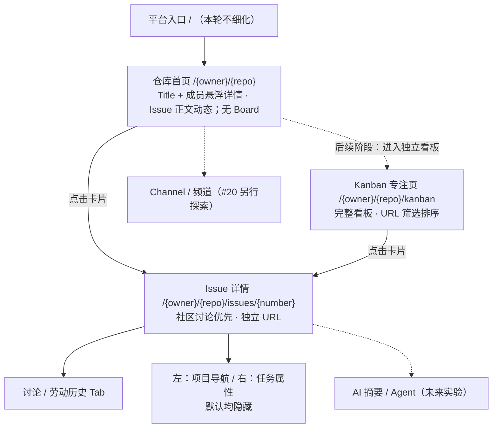

# LabourChain UI/UX 设计地图（仓库首页 · Kanban · Issue）

> **版本：v0.1 · 2026-10-26 · 设计盘点，而非功能完成报告**
>
> **主任务：** [#2 仓库项目页面 / Board / Issue](https://github.com/Ri0n72Y/hackathon-platform/issues/2)  
> **详细决策文本：** [UI/UX 设计基线](./LabourChain-Repo-Board-Issue-UX-Baseline.md)  
> **独立的社区探索：** [#20 新成员与频道参与体验](https://github.com/Ri0n72Y/hackathon-platform/issues/20)（暂不影响本设计路线）
>
> **资料边界**：本地图依据上述 Issue 和设计基线中已经记录的讨论。文中的「完成」指**设计方向/规则已经明确、已被记录**，绝不代表代码已实现、原型交互完整或用户测试通过。没有证据的阶段统一标为未完成。

## 0. 如何读这份地图

**状态类型（设计本身）**

- **✅ 决策已确认**：页面定位、重要语义或主要交互规则已经商定并记录；不需在后续轮次反复征求象征性批准。
- **🟡 部分完成**：有明确方向或低保真示意，但布局细节、真实行为或异常场景尚未收敛。
- **⬜ 待设计**：当前没有足够具体的页面/交互设计，不能仅凭候选功能判断为完成。
- **⏸ 暂缓 / 其他 Issue**：不属于当下 #2 的 Board 与 Issue UI 主要设计交付。

**交付成熟度（与上方状态不同）**

1. **D1 · 方向/语义**：用户目标、对象、信息层级和不可违反的规则明确。
2. **D2 · 界面结构**：有对应页面的布局/线框、导航与控件位置。
3. **D3 · 行为契约**：关键操作的前置条件、状态变化、可见反馈、失败与恢复均可验证。
4. **D4 · 交互验证**：真实可操作原型经过至少一次完整场景认知走查；键盘、窄屏、空态和错误路径得到检查。

**目前 D4 尚未完成。** 此前聊天中的可切换示意是**探索性低保真演示**，不等于实现路由、GitHub 写入或通过真实测试。

## 1. 页面与导航地图

**路由约束已确认**：`/` 平台入口、`/{owner}/{repo}` 仓库首页、`/{owner}/{repo}/kanban?filter=…&sort=…` 独立看板页（后置实现）、`/{owner}/{repo}/issues/{number}` 详情。第一版项目主页不展示看板，也不提供首页 Board 预览。独立看板实现后，其 URL 筛选/排序应可分享、可刷新；独立 Issue 的直接访问与 Back/Forward 需成立。具体 query 参数 schema 尚待定稿。

## 2. 分页面设计进度

| 页面 / 区域 | 已完成的设计决定 | 未完成的部分 | 现阶段判断 |
| --- | --- | --- | --- |
| **仓库首页** `/{owner}/{repo}` | 单仓库首页；Title/精简 README、成员头像悬浮详情、Repo 动态；动态正文来自所展示 Issue 的第一楼，按 Markdown 与平台扩展格式（含视频外链）渲染；第一版不显示 Board | 首屏尺寸、README 来源/折叠策略、`team-member.json` 字段与悬浮层级、Markdown/视频外链扩展边界、刷新与失败回退、真实响应式视觉稿 | 🟡 D1 部分补充、D2 低保真、D3/D4 未完成 |
| **独立 Kanban 页面（后置）** `/{owner}/{repo}/kanban` | 保留既有看板、CardItem、状态标签、筛选排序与操作设计；不嵌入项目主页；后续阶段单独实现 | **工具栏布局、详细 CardItem 信息密度、完整工作流、桌面/触屏 DnD 与大量卡片的滚动/分页** | ⏸ 设计保留，实施后置 |

| **Issue 独立详情** | 点击卡片更新 URL；社区讨论优先；左右侧栏默认隐藏且可独立展开；标题/成果摘要/话题背景；下方「讨论/劳动历史」双 Tab；右侧任务属性 | 真实信息层级、长正文展示、不同屏宽面板行为、跨 Tab 草稿保持、详情页状态反馈 | 🟡 D1 完成、D2 初稿、D3 部分、D4 未完成 |
| **仓库动态区** | 在第一版项目主页展示所展示 Issue 的第一楼正文，按 Markdown 与平台扩展格式渲染 | 更新时间、分页/刷新、摘要与跳转、加载和错误态 | 🟡 定位确认，其余待设计 |
| **频道 / 新成员参与** | 与 Board/Issue 的数据关系受现有 `channel:*` 约束 | 频道路由、视图、参与路径及视觉结构 | ⏸ 转 #20；不抢占本轮工作 |
| **AI 摘要/Agent** | 未来产品方向与实验边界已记录 | 交互和技术可行性、BYOK 安全、上下文选择与面板共存 | ⏸ 未来特色；不纳入当前 MVP |
| **跨仓库聚合与 Fork 社区** | 长期愿景已单独记录 | 不在本轮细化 | ⏸ 不属于单仓库 UI 交付 |

## 3. 横跨页面的组件与行为地图

| 组件 / 规则 | 现已确认 | 下一步需补齐 | 状态 |
| --- | --- | --- | --- |
| **CardItem（平衡密度）** | 标题、编号、多 Assignees、最近有效劳动 `outcome` + 作者、累计**主观登记工时**；紧凑模式可隐藏成果细节 | 精确视觉密度、缺失 `outcome` 的回退、Branch 是否有可靠来源、专注页扩展字段 | 🟡 |
| **Board 状态** | 有且仅有一个有效 `status:*`；可配列顺序；`archived` 默认隐藏；Open/Closed 独立，Closed 默认不显示 | 无效/冲突状态的可见提示和修复入口；Closed/归档查看与分页 | 🟡 |
| **版本** | `version:*` 默认不开启、按需启用，可**多选**；每个 Issue **仅一个整体 status**，正文区分各版本工作 | 设置入口/筛选交互、数据展示细节和缺省态 | 🟡 |
| **筛选、排序与视图** | URL 作为共享状态；确定性顺序；团队共享视图来自仓库配置（形式未定）；不无声引入每人不同的持久排序 | Query schema、筛选工具栏、配置格式、视图保存/切换的权限与反馈 | 🟡 |
| **同列拖动** | 只在当前页面临时改变排列；切换筛选/排序或刷新后恢复，不持久化到仓库或本地个人视图 | 视觉反馈、键盘替代、触屏操作、临时排序提示 | 🟡 |
| **跨列拖动** | 授权后仅修改对应的 GitHub `status:*`，不重写其他标签；失败恢复并可重试 | 提交中、冲突、授权过期、网络失败的可操作原型及验证 | 🟡 |
| **Issue Assignees / Contributors** | Assignees = 当前多人参与；Contributors = 历史已登记劳动的人；管理遵循 GitHub 权限，不自动关联；Doing 无 Assignee 是提示异常 | 元数据展示、异常筛选/提示及缺省状态 | 🟡 |
| **劳动摘要与记录** | 显示最近 `outcome`、来源、历史贡献者和主观累计工时；缺失数据不猜测；劳动记录与普通讨论分离 | 以更新的独立 Labour Record 协议校对表单、解析和 GitHub 手工 YAML 路径；失败保留输入 | 🟡 |
| **讨论输入** | 类 Discord 的底部易达输入 + 多行 Markdown；GitHub 提交明确「进行中/成功/失败」反馈 | 是否 sticky、编辑/预览/提交细节、草稿恢复、键盘可达性 | 🟡 |
| **阅读恢复** | 第一次看上下文；再次优先从未读接续；未读分界；本地浏览器 KV，非跨设备同步 | KV 键、实际已读判定、Tab 分离、滚动锚点稳定性、恢复提示 | 🟡 |
| **导航与返回** | 首页动态条目 → 对应 Issue URL；后续独立看板 → Issue URL；浏览器 Back/Forward | 来源返回路径、滚动位置恢复、直接打开后的“返回项目”语义 | 🟡 |
| **全局反馈** | 区分匿名只读、无 GitHub 写权限、空态、失败、缓存过期；不谎报成功 | 空/加载/授权/失败的页面稿、恢复机制和端到端验证 | ⬜ 设计原则已知，具体界面未完成 |

**注意**：上表的 🟡 不代表代码已写，也不代表具备可执行的精确接口契约；它只表示设计上已有可继续推进的确定内容。

## 4. 关键用户旅程的完成度

| 场景 | 已锁定的方向/规则 | 尚需完成的验证 | 状态 |
| --- | --- | --- | --- |
| **J1 新访客理解项目**：首页 → 项目介绍/成员 → Repo 动态 | 首页不展示 Board；成员悬浮详情与 Issue 正文动态已定方向 | 移动端阅读、动态可发现性、首屏密度、数据空态 | 🟡 |
| **J2 找任务（后续阶段）**：独立 Kanban → URL 筛选 → Issue | 独立看板路由保留；看板实现后使用共享筛选/排序与独立 Issue | 详细工具栏与跨页视图位置、深链接刷新 | ⏸ 后置 |
| **J3 改任务状态（后续阶段）**：独立看板跨列拖拽 → GitHub 状态标签修改 | 只写有效 `status:*`、受 GitHub 权限保护、失败恢复已定 | 看板实现后验证 Loading/Success/Failure、冲突和键盘操作 | ⏸ 后置 |
| **J4 参与讨论**：Issue → 讨论 Tab → Markdown → 发表 | 讨论优先，提交明确反馈已定 | 输入框形态、权限和失败草稿恢复 | 🟡 |
| **J5 登记劳动**：Issue → 劳动历史 Tab → 表单 → GitHub 评论 | 记录与讨论分开、兼容手工 YAML 记录的方向已定 | 最新协议、表单校验与写回/重试验证 | 🟡 |
| **J6 回访 Issue**：读取本地 KV → 未读分界 → 接续阅读 | 首访/回访规则已定 | 内容更新/删除、未读计算、边界情形 | 🟡 |
| **J7 异常恢复**：授权不足/数据失败 → 可理解反馈 → 重试 | 不虚报写入和不推断缺失数据的原则已定 | 完整错误场景原型与走查 | ⬜ |

## 5. 本阶段已完成了什么、未完成什么

### 已完成：设计共识与记录

- [x] 确定**单仓库工作区**定位与 MVP 范围边界。
- [x] 确定第一版项目主页不展示看板，采用**Title/精简介绍 → 成员悬浮详情 → Repo 动态**。
- [x] 确定**独立 Kanban 页面**的用途、路由和 URL 状态原则。
- [x] 确定**独立 Issue URL**，不使用侧栏作为默认详情导航。
- [x] 确定 Issue 的**社区优先、两侧栏默认隐藏、讨论/劳动双 Tab**结构。
- [x] 确定关键 Board 状态、版本多选与整体 status、同列临时排序与跨列写回原则。
- [x] 确定 Assignees / Contributors / 工时 / outcome 的语义边界。
- [x] 确定讨论输入、劳动表单与本地阅读进度的交互原则。
- [x] 将 AI-native 未来方向与跨仓库社区议题**隔离记录**，不混入当前交付。
- [x] 建立 [详细决策基线](./LabourChain-Repo-Board-Issue-UX-Baseline.md) 和**本设计地图**。

### 尚未完成：可交付的细节设计与验证

- [ ] Kanban **专注页**详细视觉/布局、信息密度和工具栏。
- [ ] 首页 **README、成员头像悬浮详情、Issue 正文动态的 Markdown/扩展格式渲染**，以及移动端与异常态；不包含 Board。
- [ ] Issue **完整页面**（讨论流、劳动历史、属性侧栏）在桌面和窄屏上的可操作原型。
- [ ] 表单依最新 Labour Record 协议的字段/格式核对与验证。
- [ ] 所有编辑/拖动/评论的权限、网络失败与恢复细节。
- [ ] 独立 Kanban 页面后置实现时，再验证 **Kanban → Issue → 返回** 的浏览器路由、Query 与阅读位置；第一版首页无需连接到看板。
- [ ] 关键场景的键盘、触屏、屏幕阅读与可用性评估。
- [ ] #2 原计划中的**数据流/插件边界/授权 Function 职责**技术设计与验证（本次设计地图未将技术工作伪装为 UI 已完成项）。

### 暂缓或单独追踪

- [ ] [#20](https://github.com/Ri0n72Y/hackathon-platform/issues/20)：社区 onboarding / 频道参与 / 跨仓库聚合的长期设计探索。
- [ ] AI-native 摘要、右侧 Agent、BYOK + Vercel Function 流式 Harness：未来实验，技术安全尚需独立验证。
- [ ] GitHub PR 看板、私有仓库、独立持久化后端等非当前 MVP 项。

## 6. 下一阶段执行顺序（设计，不是立刻实现）

| 顺序 | 设计交付物 | 结束条件 |
| --- | --- | --- |
| **P1 · 下一步** | **Repo 项目主页内容**：成员头像悬浮详情、Issue 第一楼的 Markdown/扩展格式渲染；看板交互设计保留但实施延后 | 能核对成员信息来源、正文与评论边界、视频外链等扩展内容及异常回退；未解决项有标注 |
| **P2** | 仓库首页完整低保真（精简 README / 成员详情 / Repo 动态；不含 Board） | 成员信息与动态正文层级清楚，首页不依赖看板即可理解项目 |
| **P3** | 独立 Issue 完整低保真（讨论/劳动、左右侧栏、Markdown 输入） | 首访/回访、评论和劳动登记的主状态都能走通 |
| **P4** | 端到端可交互原型及错误/权限状态 | 可完成 J1–J7 认知走查，覆盖 Back/Forward、移动端和恢复机制 |
| **P5 · 经评估后** | 将确认的设计约束整理为可拆分实施工作的界面规范 | 设计决策、假设和实现任务各有明确依据，不扩张 #2 原有范围 |

## 7. 维护规约

1. 每次完成一次实质性设计决策，**先更新[设计基线](./LabourChain-Repo-Board-Issue-UX-Baseline.md)**，再更新本图中对应节点；不要仅保存在聊天中。
2. 「✅」只代表**这项产品决策被确认**；不得据此把同一页面的 **D3/D4** 默认为完成。只有具备可复核的原型/走查记录时，才能将验证列升级。
3. 不以任意比例（如“设计完成 80%”）替代逐项状态。
4. 对后来改变的决定保留**旧规则 → 新规则 → 修改原因**的记录；避免老候选文字再次主导实现。
5. 需要实际代码检查才能得出的实现状态，应单独建立工程核验记录，不由本地图推断。

*状态快照时间：2026-10-26。*
