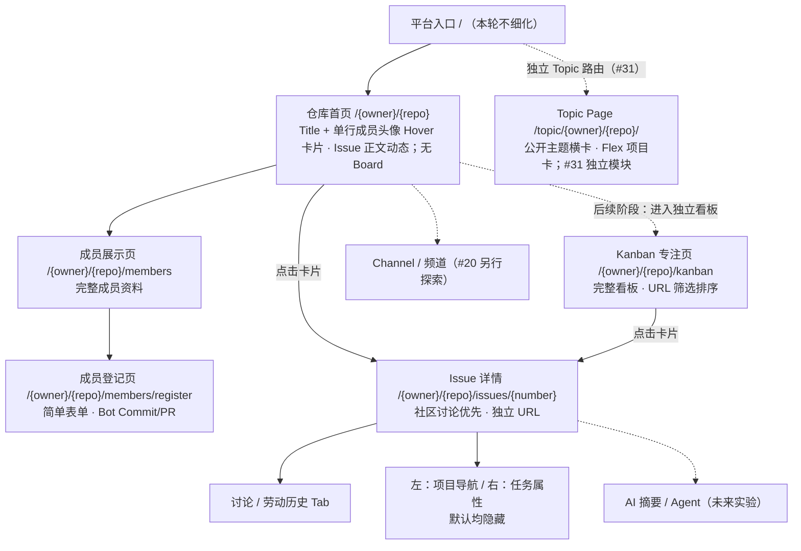

# LabourChain UI/UX 设计地图（项目 · 成员 · Issue · Topic · Kanban）

> **版本：v0.6 · 2026-11-13 · 五页面 D2 版式 + Dark/Light 双主题设计；不表示代码、TopicPage 合并或用户 D4 已完成**
>
> **主任务：** [#2 仓库项目页面 / Board / Issue](https://github.com/Ri0n72Y/hackathon-platform/issues/2)  
> **详细决策文本：** [UI/UX 设计基线](./LabourChain-Repo-Board-Issue-UX-Baseline.md)  
> **独立的社区探索：** [#20 新成员与频道参与体验](https://github.com/Ri0n72Y/hackathon-platform/issues/20)（暂不影响本设计路线）
>
> **资料边界**：本地图依据上述 Issue 和设计基线中已经记录的讨论。文中的「完成」指**设计方向/规则已经明确、已被记录**，绝不代表代码已实现、原型交互完整或用户测试通过。没有证据的阶段统一标为未完成。

## 0. 如何读这份地图

**状态类型（设计本身）**

- **✅ 决策已确认**：页面定位、重要语义或主要交互规则已经商定并记录；不需在后续轮次反复征求象征性批准。
- **🟡 部分完成**：有明确方向或低保真示意，但布局细节、真实行为或异常场景尚未收敛。
- **⬜ 待设计**：当前没有足够具体的页面/交互设计，不能仅凭候选功能判断为完成。
- **⏸ 暂缓 / 其他 Issue**：不属于当下 #2 的 Board 与 Issue UI 主要设计交付。

**交付成熟度（与上方状态不同）**

1. **D1 · 方向/语义**：用户目标、对象、信息层级和不可违反的规则明确。
2. **D2 · 界面结构**：有对应页面的布局/线框、导航与控件位置。
3. **D3 · 行为契约**：关键操作的前置条件、状态变化、可见反馈、失败与恢复均可验证。
4. **D4 · 交互验证**：真实可操作原型经过至少一次完整场景认知走查；键盘、窄屏、空态和错误路径得到检查。

**目前 D4 尚未完成。** 此前聊天中的可切换示意是**探索性低保真演示**，不等于实现路由、GitHub 写入或通过真实测试。

### 0.1 新增视觉决策与证据范围（2026-11-12）

- ✅ **视觉方向 D1 已确认**：采用《绝区零》绳网（Inter-Knot）的模块化卡片、胶囊标签与少量明黄信号语言，融合 Discord **偏蓝的蓝紫主色**；**既有五页暗色稿为 Dark Mode，用户新增要求完整 Light Mode**，双主题共享布局。
- 🟡 **双主题规范 D2 柔和修订**：Dark 保留原定深色 Token；Light 改用**暖灰白画布、暖白卡、柔灰紫分区、低饱和偏蓝蓝紫链接与按钮**，并保留成功/错误/焦点的可辨识状态。见 [Dark/Light 视觉风格与配色规范](./LabourChain-Visual-Style-Guide.md)。**Light 柔和方向已由用户提出，具体色值及切换机制仍是 D2 建议，待真实页面审阅**。
- ✅ **五页面 D2 主布局已确认**：产品方确认此前对话演示的 Repo Home、成员列表、成员登记、Issue 详情和独立 Topic Page 方案；详细桌面/手机结构及语义边界见 [五页面布局设计](./LabourChain-Five-Page-Layout-Design.md)。**具体像素值仍是 D2 建议，用户 D4 未验收**。
- 🟡 **绳网布局证据**：游戏截图显示顶部胶囊分区及三列封面贴文，同人源码有瀑布流与详情响应式分区；LabourChain 采用其卡片信息层次，**Repo Feed 保留单列长文，TopicPage 使用封面项目卡**。证据与候选尺寸见 [布局研究](./LabourChain-InterKnot-Layout-Study.md)。
- ⬜ **双主题源码落地 / 用户 D4 未完成**：既有浅色原型与新增 Light Token/状态并未统一，也没有完整 Dark。仅设计文档更新，没有业务 CSS 变更、线上实测或 Vercel 权限访问；#51 继续由用户实际验收。

**与旧状态的关系：** 原设计主要确认信息层级和交互；现已确定一致的绳网式五页结构 + Dark/Light 两套外观。旧的浅色源码不能直接视为新的 Light Mode 合格实现，也不能作为双主题验收完成的证据。

## 1. 页面与导航地图

**路由约束已确认**：`/` 平台入口、`/{owner}/{repo}` 仓库首页、`/{owner}/{repo}/members` 成员展示页、`/{owner}/{repo}/members/register` 成员登记页、`/{owner}/{repo}/kanban?filter=…&sort=…` 独立看板页（后置实现）、`/{owner}/{repo}/issues/{number}` 详情。**另有 #31 独立公开 Topic Page**：`/topic/{owner}/{repo}/`，不核验 Installation；不等同 #3 的平台级已接入 Topic 信息流。第一版项目主页不展示看板，也不提供首页 Board 预览。独立看板实现后，其 URL 筛选/排序应可分享、可刷新；独立 Issue 的直接访问与 Back/Forward 需成立。具体 query 参数 schema 尚待定稿。

## 2. 分页面设计进度

| 页面 / 区域 | 已完成的设计决定 | 未完成的部分 | 现阶段判断 |
| --- | --- | --- | --- |
| **全站视觉风格** | 绳网式五页主布局与偏蓝蓝紫主色已确认，明确 **Dark/Light 两套主题**；[双主题配色](./LabourChain-Visual-Style-Guide.md)和[五页版式](./LabourChain-Five-Page-Layout-Design.md)可追溯 | Light 颜色细节、主题切换入口/偏好机制、双主题样式落地、窄屏/200% 与用户 D4 尚待审阅/实施/验收 | ✅ 双模式与 D2 主结构已确认；🟡 Light 色值及机制候选；D4 未测 |
| **仓库首页** `/{owner}/{repo}` | 已确认 D2：宽幅 Hero → 单行 Team 头像 → **单列文章式 Repo Feed**；Description 优先、Issue 第一楼 Markdown 与媒体外链保留原文层次；不含 Board | 色值/间距落地、移动端与真实 README/Markdown 显示；用户 D4 走查 | ✅ D2 主布局已确认；已有 D3 规则；D4 未测 |
| **成员展示页** `/{owner}/{repo}/members` | 已确认 D2：资料卡桌面双列、窄屏单列，头像/姓名/角色/完整介绍/真实外链；按 JSON 顺序；有权限时可添加 | 真实资料、空态、窄屏和键盘/读屏走查 | ✅ D2 主布局已确认；已有 D3 规则；D4 未测 |
| **成员登记页** `/{owner}/{repo}/members/register` | 已确认 D2：单列约 640px 表单、真实操作者/展示分支提示、字段旁错误与结果状态；Bot Commit/PR 既有规则不变 | 实际权限、Bot 结果、表单异常与窄屏/键盘用户验收 | ✅ D2 主布局已确认；已有 D3 规则；D4 未测 |
| **独立 Kanban 页面（后置）** `/{owner}/{repo}/kanban` | 保留既有看板、CardItem、状态标签、筛选排序与操作设计；不嵌入项目主页；后续阶段单独实现 | **工具栏布局、详细 CardItem 信息密度、完整工作流、桌面/触屏 DnD 与大量卡片的滚动/分页** | ⏸ 设计保留，实施后置 |
| **Kanban 设计保留说明** | #23 的 Namespace/最大标签、跨列只改受管标签、同列清空 Filter 后临时排序、团队共享视图和归档过滤均作为**后续实现的有效设计输入**，仅开发优先级调整 | 复核配置 `views` 格式与操作细节，不在当前 MVP 首页提前实现 | ⏸ |

| **Issue 独立详情** | 已确认 D2：标题/正文先行、真实成果摘要（有则显示）、下方讨论/劳动历史双 Tab、左右辅助侧栏默认隐藏按需展开；保留独立 URL | 真实数据、长正文与窄屏面板行为、草稿、权限与用户 D4 | ✅ D2 主布局已确认；D3 部分；D4 未测 |
| **仓库动态区** | 单列 Markdown 长文卡片，Issue 标题高于正文 H1，清晰来源/状态/展开/详情入口；保留现有分页/刷新规则 | 实际长文、媒体、加载/错误和窄屏用户复核 | ✅ D2 主布局已确认；D4 未测 |
| **Topic Page · #31** `/topic/{owner}/{repo}/` | 已确认 D2：真实主办方封面优先的紧凑横向主题卡 + Flex 自适应项目卡片流；README 标题/正文，底部可选 email/datetime；独立公开 Topic 聚合，不宣称已接入平台 | PR #64 尚未合并；实际 Cover/白名单/分页/错误及写入权限、手机与用户 D4 待验收 | ✅ D2 主布局已确认；D4 未测 |
| **频道 / 新成员参与** | 与 Board/Issue 的数据关系受现有 `channel:*` 约束 | 频道路由、视图、参与路径及视觉结构 | ⏸ 转 #20；不抢占本轮工作 |
| **AI 摘要/Agent** | 未来产品方向与实验边界已记录 | 交互和技术可行性、BYOK 安全、上下文选择与面板共存 | ⏸ 未来特色；不纳入当前 MVP |
| **跨仓库聚合与 Fork 社区** | 长期愿景已单独记录 | 不在本轮细化 | ⏸ 不属于单仓库 UI 交付 |

## 3. 横跨页面的组件与行为地图

| 组件 / 规则 | 现已确认 | 下一步需补齐 | 状态 |
| --- | --- | --- | --- |
| **TeamAvatar / MemberPopover** | 主页单行头像；鼠标 Hover、键盘聚焦、触屏点击打开同一非模态卡片；指针可移入卡片；Escape/外部点击关闭；缺失头像回退首字母 | 真实组件的焦点顺序、视口边界定位、窄屏与读屏走查 | 🟡 D1–D3 已明确，D4 未完成 |
| **MemberProfile / RegisterMemberForm** | `/members` 完整资料页；`/members/register` 单列表单；GitHub 账号选填；Bot 写入与操作者归属分离；PR 未合并不提前显示 | 真实 GitHub App 权限、分支保护、SHA 冲突与端到端状态走查 | 🟡 D1–D3 已明确，技术验证/D4 未完成 |
| **CardItem（平衡密度，后置细化）** | 标题、Issue 编号、多 Assignees 等基础任务信息保留；#23 的**不显示劳动工时/outcome**与现行基线的**显示最近劳动成果与工时**均是历史设计版本，待 Kanban 阶段确认最终密度，不能因优先级后置否定原设计 | 卡片是否展示劳动摘要、尺寸、Branch 来源、长文本回退 | ⏸ |
| **Board 分列规则（后置）** | 可选仓库配置的有效 Namespace；多有效标签按配置顺序最大者归列；任何 Namespace 下 `status:archived` 默认隐藏，明确在 Filter 选择「包含 archived」才显示；GitHub Open/Closed 独立，Closed 默认隐藏。不是只能用 `status:*` 分列 | 标签异常、权限、Closed/归档分页 | ⏸ |
| **版本** | `version:*` 默认不开启、按需启用，可**多选**；每个 Issue **仅一个整体 status**，正文区分各版本工作 | 设置入口/筛选交互、数据展示细节和缺省态 | 🟡 |
| **筛选、排序与视图** | URL 作为共享状态；确定性顺序；团队共享视图来自仓库配置（形式未定）；不无声引入每人不同的持久排序 | Query schema、筛选工具栏、配置格式、视图保存/切换的权限与反馈 | 🟡 |
| **同列拖动** | 只在当前页面临时改变排列；切换筛选/排序或刷新后恢复，不持久化到仓库或本地个人视图 | 视觉反馈、键盘替代、触屏操作、临时排序提示 | 🟡 |
| **跨列拖动（后置）** | 仅修改当前选定 Namespace 的来源列/目标列标签，其余标签保留；重新读取依最大有效标签归列，须权限校验与失败恢复 | 提交中、冲突、授权过期、网络失败的可操作原型 | ⏸ |
| **Issue Assignees / Contributors** | Assignees 是当前多人参与；Contributors 只从当前 Issue 的有效劳动记录取得历史作者，不进行跨 Issue 汇总，身份不自动关联；Doing 无 Assignee 是提示异常 | 元数据/异常提示与缺省态 | 🟡 |
| **Issue 内劳动摘要与记录** | 当前 Issue 的有效 Labour Record、最近成果、作者和主观工时独立于讨论呈现，不聚合仓库其他 Issue；CardItem 是否出现该信息仍有上述设计版本差异 | §9.4 协议、`hr` 有/无 `h`、表单/手写 YAML 一致性、来源/冲突和失败恢复 | 🟡 |
| **讨论输入** | 类 Discord 的底部易达输入 + 多行 Markdown；GitHub 提交明确「进行中/成功/失败」反馈 | 是否 sticky、编辑/预览/提交细节、草稿恢复、键盘可达性 | 🟡 |
| **阅读恢复** | 第一次看上下文；再次优先从未读接续；未读分界；本地浏览器 KV，非跨设备同步 | KV 键、实际已读判定、Tab 分离、滚动锚点稳定性、恢复提示 | 🟡 |
| **导航与返回** | 首页动态条目 → 对应 Issue URL；后续独立看板 → Issue URL；浏览器 Back/Forward | 来源返回路径、滚动位置恢复、直接打开后的“返回项目”语义 | 🟡 |
| **全局反馈** | 区分匿名只读、无 GitHub 写权限、空态、失败、缓存过期；不谎报成功 | 空/加载/授权/失败的页面稿、恢复机制和端到端验证 | ⬜ 设计原则已知，具体界面未完成 |

**注意**：上表的 🟡 不代表代码已写，也不代表具备可执行的精确接口契约；它只表示设计上已有可继续推进的确定内容。

## 4. 关键用户旅程的完成度

| 场景 | 已锁定的方向/规则 | 尚需完成的验证 | 状态 |
| --- | --- | --- | --- |
| **J1 新访客理解项目**：首页 → 项目介绍/成员 → Repo 动态 | 首页不展示 Board；成员悬浮详情与 Issue 正文动态已定方向 | 移动端阅读、动态可发现性、首屏密度、数据空态 | 🟡 |
| **J2 找任务（后续阶段）**：独立 Kanban → URL 筛选 → Issue | 独立看板路由保留；看板实现后使用共享筛选/排序与独立 Issue | 详细工具栏与跨页视图位置、深链接刷新 | ⏸ 后置 |
| **J3 改分列标签（后续阶段）**：独立 Kanban 跨列拖拽 → GitHub 受管标签修改 | 只移除当前选定 Namespace 的来源标签并添加目标标签，保留其他标签；须 GitHub 实际授权、失败恢复 | 看板实现后验证状态、冲突与键盘操作 | ⏸ 后置 |
| **J4 参与讨论**：Issue → 讨论 Tab → Markdown → 发表 | 讨论优先，提交明确反馈已定 | 输入框形态、权限和失败草稿恢复 | 🟡 |
| **J5 登记劳动**：Issue → 劳动历史 Tab → 表单 → GitHub 评论 | 当前 Issue 的结构化记录与普通讨论分离；采用产品规格 §9.4，`hr` 有/无 `h` 均为可统计小时 | 验证表单/手写 YAML、写入后读取、错误恢复 | 🟡 |
| **J6 回访 Issue**：读取本地 KV → 未读分界 → 接续阅读 | 首访/回访规则已定 | 内容更新/删除、未读计算、边界情形 | 🟡 |
| **J7 异常恢复**：授权不足/数据失败 → 可理解反馈 → 重试 | 不虚报写入和不推断缺失数据的原则已定 | 完整错误场景原型与走查 | ⬜ |
| **J8 管理团队成员**：项目主页头像 → 成员页 → 登录/权限检查 → 登记表单 → Bot Commit/PR | 单行头像 Hover 卡片、成员页、选填 GitHub 账号、当前展示分支目标、操作者归属和 PR 待合并反馈已定 | 实际 OAuth/Repo 权限、Bot Contents/PR 权限、SHA 冲突、触屏/键盘/窄屏完整走查 | 🟡 D1–D3 已明确，D4/真实写入未完成 |

## 5. 本阶段已完成了什么、未完成什么

### 已完成：设计共识与记录

- [x] 确定**单仓库工作区**定位与 MVP 范围边界。
- [x] 确定第一版项目主页不展示看板，采用**Title/精简介绍 → 成员悬浮详情 → Repo 动态**。
- [x] 确定**独立 Kanban 页面**的用途、路由和 URL 状态原则。
- [x] 确定**独立 Issue URL**，不使用侧栏作为默认详情导航。
- [x] 确定 Issue 的**社区优先、两侧栏默认隐藏、讨论/劳动双 Tab**结构。
- [x] 确定关键 Board 状态、版本多选与整体 status、同列临时排序与跨列写回原则。
- [x] 确定 Assignees / Contributors / 工时 / outcome 的语义边界。
- [x] 确定 Team 单行头像、Hover 详情卡片、`/members` 与 `/members/register` 路由、成员 JSON 最小字段和 Bot Commit/PR 交互契约。
- [x] 确定讨论输入、劳动表单与本地阅读进度的交互原则。
- [x] 将 AI-native 未来方向与跨仓库社区议题**隔离记录**，不混入当前交付。
- [x] 建立 [详细决策基线](./LabourChain-Repo-Board-Issue-UX-Baseline.md) 和**本设计地图**。

### 尚未完成：可交付的细节设计与验证

- [ ] Kanban **专注页**详细视觉/布局、信息密度和工具栏。
- [ ] 新视觉 Token 的页面落点：画布、Hero/Team/Feed、成员资料与登记、Issue 详情、Topic Page 及输入状态；按用户确认的暗色蓝紫基线复核真实显示。
- [ ] 首页 README 与 Issue 正文 Markdown/扩展格式渲染，以及移动端与异常态；不包含 Board。
- [ ] Team Hover 卡片、成员页与登记表单的真实组件/窄屏/键盘/读屏走查；Bot Contents/PR 权限和 GitHub 写入链路必须真实验证。
- [ ] Issue **完整页面**（讨论流、劳动历史、属性侧栏）在桌面和窄屏上的可操作原型。
- [ ] 以产品规格 §9.4 校验表单、手写 YAML、`hr` 可选 `h` 和当前 Issue 关联规则，记录真实已验证步骤。
- [ ] 所有编辑/拖动/评论的权限、网络失败与恢复细节。
- [ ] 独立 Kanban 页面后置实现时，再验证 **Kanban → Issue → 返回** 的浏览器路由、Query 与阅读位置；第一版首页无需连接到看板。
- [ ] 关键场景的键盘、触屏、屏幕阅读与可用性评估。
- [ ] #2 原计划中的**数据流/插件边界/授权 Function 职责**技术设计与验证（本次设计地图未将技术工作伪装为 UI 已完成项）。

### 暂缓或单独追踪

- [ ] [#20](https://github.com/Ri0n72Y/hackathon-platform/issues/20)：社区 onboarding / 频道参与 / 跨仓库聚合的长期设计探索。
- [ ] AI-native 摘要、右侧 Agent、BYOK + Vercel Function 流式 Harness：未来实验，技术安全尚需独立验证。
- [ ] GitHub PR 看板、私有仓库、独立持久化后端等非当前 MVP 项。

## 6. 下一阶段执行顺序（设计，不是立刻实现）

| 顺序 | 设计交付物 | 结束条件 |
| --- | --- | --- |
| **P0 · 当前新增** | **已确认五页 D2 主布局与 Dark/Light 双主题需求**：按[五页设计](./LabourChain-Five-Page-Layout-Design.md)和[成套 Token](./LabourChain-Visual-Style-Guide.md)对照所有页面；保留业务语义及接口约束 | 两套颜色/状态实现、主题切换入口和持久性待产品/工程确认；CSS 与用户 D4 未完成 |
| **P1 · 原有** | **Repo 项目主页与团队成员管理设计交付**：单行头像 Hover、`/members`、`/members/register` 与 Issue 第一楼 Markdown/扩展格式；看板交互设计保留但实施延后 | 成员资料来源、表单校验、Bot/操作者归属、Commit/PR 状态及窄屏/键盘行为均有明确契约；技术权限缺口单独标注 |
| **P2** | 仓库首页完整低保真（精简 README / 成员详情 / Repo 动态；不含 Board） | 成员信息与动态正文层级清楚，首页不依赖看板即可理解项目 |
| **P3** | 独立 Issue 完整低保真（讨论/劳动、左右侧栏、Markdown 输入） | 首访/回访、评论和劳动登记的主状态都能走通 |
| **P4** | 端到端可交互原型及错误/权限状态 | 可完成 J1–J8 认知走查，覆盖 Back/Forward、移动端和恢复机制 |
| **P5 · 经评估后** | 将确认的设计约束整理为可拆分实施工作的界面规范 | 设计决策、假设和实现任务各有明确依据，不扩张 #2 原有范围 |

## 7. 维护规约

1. 每次完成一次实质性设计决策，**先更新[设计基线](./LabourChain-Repo-Board-Issue-UX-Baseline.md)**，再更新本图中对应节点；不要仅保存在聊天中。
2. 「✅」只代表**这项产品决策被确认**；不得据此把同一页面的 **D3/D4** 默认为完成。只有具备可复核的原型/走查记录时，才能将验证列升级。
3. 不以任意比例（如“设计完成 80%”）替代逐项状态。
4. 对后来改变的决定保留**旧规则 → 新规则 → 修改原因**的记录；避免老候选文字再次主导实现。
5. 需要实际代码检查才能得出的实现状态，应单独建立工程核验记录，不由本地图推断。

*原设计状态快照：2026-10-29；2026-11-05 选择性同步 #23；2026-11-12 增加视觉方向与源码色彩差距记录。Kanban 的已有设计仍有效、实施后置；并不代表其已实现或 D4 已通过。*
