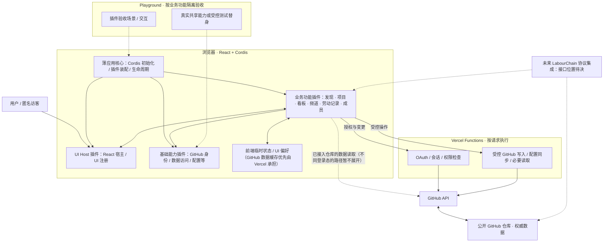

# Hackathon Platform — Architecture Map

> **状态：讨论草稿 v0.2（2026-10-25）**  
> **用途：** 先建立全局拼图，再按证据和用户决策填补空缺。本文不是已生效的工程规范，也不意味着建议模块已经实现。  
> **基线：** `Ri0n72Y/hackathon-platform` 的 `main` 分支、MVP 产品规格、Issues #1/#2/#5/#13、用户明确确认的全栈功能插件与 Playground 验收边界、Project Team v3。PR #14 不是用户确认的架构决定，不纳入此文档的决定性依据。

## 0. 标记方式

- **[约束]** 用户明确的产品或技术约束，或 MVP 规格已有明确规定的范围。
- **[现状]** 在当前 `main` 中已观察到的代码或文件；不表示生产验证通过。
- **[方向]** 当前采用的讨论方向，具体定义和验收标准尚待确定。
- **[待决]** 需要用户与 Architecture Steward 讨论后确定。
- **[待验证]** 需要代码实验、部署或专项研究支持，不能仅凭设计推断。
- **[规格已定义]** MVP 产品规格 Draft 0.1 已写明的领域语义；不是实现已完成或额外用户批准。
- **[规格差异]** 旧规格与后续用户明确决策存在差异；保留可追溯依据，待产品规格同步。
- **[待研究]** 已明确研究目标但尚无验证结论；可由专项 Issue 跟踪。
- **[暂缓]** 当前不研究或实施；与未解决的阻塞问题分开记录。
- **[后续]** 本轮不需要细化，不因此提前搭建基础设施。

## 1. 产品及运行边界

**[约束]** 平台面向黑客松团队和开源协作社区。MVP 通过公开 GitHub 仓库提供项目发现、Issue 看板、频道讨论和基础劳动记录。React 负责 UI；Cordis 负责插件及服务组织；Vercel 承载网页和 Functions；GitHub App 提供用户授权与仓库访问；GitHub 仓库是主要业务数据源；不建立传统在线业务数据库；保留 LabourChain 协议未来接入位置。

**[约束]** MVP 不包括私有仓库、PR 看板、跨平台 Git 适配器、持续后台同步、常驻 Worker、完整 LabourChain 协议或价值计算。细粒度权限、私有频道、独立 Thread、完整成员履历、声誉/贡献排名及完整异常诊断界面同样不在 MVP 范围；无效数据诊断界面可后置。产品规格所描述的 `labourchain.config.yaml`、`status:*`、`channel:*`、`CardItem`、`Asset` 和劳动记录属于已提出的产品/数据契约；不是已实现的代码模块。

**[约束·用户确认]** 将平台设计为**全栈业务功能插件的组合**。插件围绕一个完整、可验收的业务功能，而不是单个函数、组件或 API 操作；也不应同时吞并多个复杂且完整的业务模块。插件可以按需包含 UI、Cordis 服务、领域逻辑和服务端 Function，但前后端各自的代码与运行职责须保持可辨识，不能混成不可维护的大模块。

**[约束·用户确认]** 插件无需独立部署：MVP 统一部署平台。部分功能插件能在类似 Storybook 的 **Playground** 中运行；**每个业务插件都应能在 Playground 中按自身能力单独验收**。这一点指功能可隔离验证，不表示运行时必须零依赖，也不要求所有插件都提供独立可见页面。Playground 可通过明确的共享服务或受控测试替身提供前置能力。

**[约束·用户确认]** GitHub App 安装并授权仓库即视为该公开仓库接入平台，不设平台内部第二次绑定流程；未经 App 授权的公开仓库不作为平台项目。安装授权与用户登录 OAuth 仍是两个不同的 GitHub 授权机制。

**[约束·用户确认]** 采用**薄应用核心（Thin Core）+ 基础能力插件 + 业务功能插件**的责任划分：应用核心仅负责运行环境启动、Cordis Context 创建、插件装配与生命周期协调，不包含 GitHub 或看板等业务语义；UI 注册与 React 宿主、GitHub 身份接入、数据访问等可复用能力通过 Cordis 插件提供；业务功能插件消费所需服务并拥有各自的业务闭环。Playground 是另一种插件组合与验收入口，不是单独重写业务实现。

**[待决]** 一个逻辑功能插件是否对应独立包、Function 文件布局、如何组织 Playground 场景及如何验证真实 GitHub 写入，均不在此轮冻结。

## 2. 技术架构全局地图

这张图表示**逻辑边界**，不是部署拓扑的最终细节。**生产应用和 Playground 复用业务插件，而不是分开维护两套功能实现。** Playground 既能展示交互，也应能检查业务效果与失败路径；仅看到 UI 渲染，不等于一个依赖真实 GitHub 写入的闭环已经通过端到端验收。

### P1 全栈插件与 Serverless 运行边界（已确认）

**[约束·用户确认]** **浏览器端使用 Cordis 插件运行时，服务端使用普通 Vercel Functions**。MVP 不在 Functions 侧创建第二套 Cordis Context、插件装载与生命周期系统。当前 Serverless 的按请求执行模型不需要服务端动态插件组合；额外运行时会增加无需求支撑的启动与装配负担。

**[架构原则]** 一个“全栈业务插件”是按业务责任形成的**逻辑功能单元**，不是要求在前后端都运行 Cordis：浏览器中的 Cordis 插件提供服务和 UI；同一业务能力需要后端时，由普通 Function 入口承担认证、权限校验、GitHub 写入等服务端职责。相关领域解析和校验可在适用时复用普通 TypeScript 代码；是否放入同一包、Function 入口怎样组织，待实际功能落地时确定。前后端不共享运行时实例、Cordis Context 或浏览器状态。

**[现状]** 当前代码已经采用浏览器 Cordis + `api/*.mjs` Functions 的执行形式，但服务端文件与业务插件的逻辑归属仍未系统化整理；本决策确认目标边界，不把当前实现的文件布局视为最终标准。

**[后续]** 若未来真正出现需要服务端动态装载与替换插件的场景，应依据具体需求重新评估运行时；当前不为此建设基础设施。

## 3. 功能拼图（不是立即拆包清单）

| 功能区域 | 核心责任（高层） | 对照现状 | 状态 |
| --- | --- | --- | --- |
| Platform Core / Bootstrap | 创建 Cordis Context、装配与释放插件；不含业务逻辑 | `apps/playground/src/runtime.tsx` | [约束·用户确认] 薄核心；[现状] 基础原型 |
| React UI Host（基础能力插件） | 唯一 React 宿主及 UI 注册、组合 | `plugins/react-ui/` | [约束·用户确认] 归插件；[现状] 已有原型 |
| Playground / Acceptance Harness | 按业务场景单独装配插件并观察可验收行为，可按需使用可控依赖 | 现有 `apps/playground/` 目前是整体原型入口 | [约束] 需要插件级验收；场景设计 [待决] |
| GitHub Identity & Access | App OAuth、会话、权限与安装范围校验 | `api/github-login.mjs`、`github-callback.mjs`、`github-verify.mjs` | [现状] 局部实现；完整安全验收 [待验证] |
| GitHub Data Access | 仓库 / Issue / 评论 / Commit 的读取与错误处理；缓存优先由 Vercel 托管 | `plugins/repo-issues/`、`api/_github.mjs`、`issues.mjs` 等 | [现状] 固定 Installation ID 的测试链路；动态仓库定位 [待研究：#18] |
| Project / Repository | 仓库级根对象、已授权安装范围、项目视图及仓库配置读取 | 当前仓库选择界面 | [规格已定义] 仓库及页面语义；[已确认] 安装授权即接入；流程待实现 |
| Config & Label Management | 根配置解析、Namespace 三态校验、仅对受管 Issue 标签进行同步 | MVP 规格 §5–6 | [规格已定义] 管理与清理边界；[现状] 未实现完整同步 |
| Issue Board | Issue → CardItem、按视图可选 Label Namespace 分列、置顶、Filter/URL 视图与本地手动排序；受控标签变更 | 当前为 Issue 列表与手动创建 / 评论 | [约束·用户补充] 视图规则已明确；[现状] 完整看板未实现 |
| Channels | 有效频道 Issue 选择、评论与按配置启用的 Wishlist 展示 | MVP 规格 §8 | [规格已定义] 频道语义；[现状] 未实现 |
| Labour Records（Issue 内） | 仅在当前 Issue 详情内按需解析和汇总其关联的结构化评论及 Commit 劳动来源；Board 卡片不显示劳动记录，也不做跨 Issue 统计 | MVP 规格 §9.3–9.4、后续用户范围决定 | [已确认] Issue 局部展示；整体劳动统计待自有后端阶段 |
| Team / Members | 可选 `team-index/` 成员索引，允许没有 GitHub 账号的参与者 | MVP 规格 §10 | [规格已定义] 最小结构；字段契约后置，未实现 |
| Discovery / Index | 从公共索引进入项目、项目卡片 | MVP 规格定义；#4 后置 | [方向] 未实现；具体索引契约 [待决] |
| LabourChain Integration | 后续正式协议集成边界 | MVP 明确不运行完整协议 | [后续] 只预留演进位置 |

**[约束·用户确认]** 功能模块沿纵向拥有自己的业务闭环与可验收行为；可依赖明确声明的共享能力。这里的功能区域不是一一对应的最终插件数，具体分合应由业务闭环、复杂度和可独立验收性共同决定。

### 3.1 插件边界的初步判断（已确认的原则，不是拆包清单）

- **合适的边界：** 例如“Issue 看板”能够加载任务、按当前视图指定的 Label Namespace 分列并触发受控标签变更；可以在 Playground 中提供测试仓库数据与受控写入模拟，检验完整交互路径。
- **太细：** 仅为 `parseStatusLabel()` 或单个按钮包装 Cordis 插件；应优先作为业务插件内部的普通函数或组件。
- **太大：** 一个插件同时独立实现看板、频道、成员和劳动记录等多个完整业务领域；应检查其是否含有多个可单独验收的业务闭环。
- **独立验收 ≠ 零依赖：** 共享身份、数据访问等能力可以以真实实现或测试替身提供；插件不应为了 Playground 而复制整套平台。模拟验收与真实 GitHub/Vercel 集成验证应明确区分。

### P5a 看板视图、置顶与手动排序（已确认的视图契约）

以下为用户从看板专项讨论补充的**[约束·用户确认]**，属于 Issue Board 功能的视图规则；不构成平台级通用过滤器或书签框架。

- **分列规则：** 当前看板视图可以选择 **`labourchain.config.yaml` 中已声明且定义了有效分列标签的 GitHub Label Namespace**；不允许使用未在该配置中声明的 Namespace 分列。`status:*` 不再是所有看板视图的唯一分列依据。所选 Namespace 决定 Issue 显示在哪一列；这直接沿用 MVP 规格 §5.2–5.3 的受管 Namespace 与有效标签语义，并非新增一套独立配置规则。特殊 `pinned` 标签只控制列内置顶，不作为分列 Namespace。
- **全局置顶：** Issue 添加特殊 `pinned` Label 后，始终排在其所属列顶部，**不受当前视图分列 Namespace 的影响**。它改变列内优先级，不代替分列所属关系；即使使用手动排序模式，`pinned` 的置顶语义也成立。
- **可共享的 Filter 视图：** 普通视图的筛选/排序规则通过 **URL Query Parameters** 表达；修改 Filter 应同步更新 URL，分享该 URL 可恢复该视图规则。它表达视图而非 GitHub 上的额外任务排序字段。
- **本地手动排序：** 用户在同列拖动调整**显示顺序**后，当前 Filter **直接失效并清空**，界面显示「**手动排序**」。顺序仅在**当前页面会话中临时生效**，不写入 GitHub、也不保存跨页面的个人排序；重新选择筛选/排序、刷新或重访 URL 后恢复默认顺序。**该手动排序视图不支持分享**，不能将不含 Filter 的 URL 宣称为可复现的手动排列。
- **常用视图：** 允许把常用 Filter/视图定义保存到仓库配置目录（如 `configs/`）或单独书签文件，由网页加载。**具体文件位置与格式待确定**；不将本地手动排序隐式转为可分享配置。

**[跨列拖动·用户已确认]** 跨列拖动是 GitHub 写入：根据当前看板选定的、由仓库配置声明的**分列 Namespace**，只修改该 Issue 在**该 Namespace 内**的受管 Label，使其对应目标列的有效标签；不得顺带改写 `status:*`（当当前分列不是 `status` 时）、`version:*` 或其他 Namespace 与无关标签。Function 须按最新配置校验目标值、当前用户权限及实际写入结果，失败或冲突不能假装已成功。**同列拖动只改变临时显示顺序**，不是 GitHub 写入。

**[边界与待细化]** `pinned` 是独立的 GitHub 置顶 Label，仍在当前 Namespace 的所属列内优先；Filter/URL 表达可恢复的视图条件。刷新/重访会清除手动排列。保留的具体实施问题是：变更分列 Namespace 时是否保留某些交互选择、同为 `pinned` 的卡片如何稳定排序、非 `status` Namespace 下如何显示 `status:archived`；这些尚未获得独立规则，不因确定跨列写入而推断。

**[规格差异·待同步]** 当前 [MVP 产品规格](https://github.com/Ri0n72Y/hackathon-platform/blob/main/docs/LabourChain-MVP-Product-Spec.md) §7 仍以 `status:*` 为固定看板列、§7.3 仍写“筛选/排序偏好保存在本地”。后续确认的「可选 Namespace 分列、按所选 Namespace 跨列写标签、URL Filter、同列手动排序清空 Filter 且只在页面临时生效」优先于旧规格；这里记录差异，旧产品规格应另行在适当任务中同步，不将历史表述当作当前规则。

### P5b 配置与 Label 管理边界（MVP 规格 §5–6 已定义）

**[规格已定义]** 根目录的 `labourchain.config.yaml` 是仓库级配置入口，负责有效标签、频道、显示方式和**由平台管理的 Namespace**。浏览器负责读取/解析用于展示的配置；服务端 Function 对写入、配置或标签同步须重新校验当前配置与 GitHub 用户权限。确切 Schema 和字段名尚未冻结，**不要因此重议下面已确定的语义**。

| 配置中某 Namespace 的状态 | 平台行为 |
| --- | --- |
| 不存在 | 不归平台管理，不检查也不修改；看板亦不能选择其作为分列 Namespace |
| 存在，且有效标签非空 | 纳入受管范围，仅配置声明的标签值有效；看板选择分列时使用该 Namespace 的有效标签 |
| 存在，但有效标签列表为空 | 仍在受管范围，但没有有效分列值；同步时清理 Issue 上属于该 Namespace 的标签 |

**[规格已定义]** 匹配以**完整命名空间前缀**为准，`foo:` 不等于 `foobar:`。删除整个 Namespace 配置意味着**停止管理且不自动清理**；保留配置但将列表设为空意味着**清理受管 Issue 上对应 Namespace 的标签**。这是两个不同的操作，不得合并为一个“删除标签”行为。

**[规格已定义]** 首次接入或配置变更时的 Label 同步由受控 Vercel Function 执行：读取仓库配置与状态、验证配置和用户权限、创建缺失的仓库级 Label 定义、检查 Issue 标签并清理受管 Namespace 下的无效值。**不删除仓库级 Label 定义、不主动处理 PR、不触碰未声明受管的 Namespace**。一轮同步包含多次 GitHub API 调用，**不是原子事务**；必须保留逐项失败信息与安全重试边界。

**[已确认·衔接]** GitHub App 安装并授予仓库访问权即完成平台接入，不附加第二次业务“绑定”。安装权限、项目接入与上述配置/Label 初始化属于不同责任；**不能因为已经接入就假定配置有效或同步已经成功**。动态 Installation 定位另由 [Issue #18](https://github.com/Ri0n72Y/hackathon-platform/issues/18) 研究。

**[边界]** `pinned` 是另行确认的特殊置顶标签，独立于当前分列 Namespace；它的创建、权限和与受管 Namespace 的关系需在具体写入实现中按既有权限约束核对，不将其当作可选择的分列 Namespace。

### P5c 看板与频道的业务判定（MVP 规格 §7–8 已定义）

**[规格已定义·看板]** 默认读取 **Open Issue**，Closed 默认不展示；用户主动打开“显示已关闭”后再分页读取 Closed，不强制一次获取全部历史 Issue。GitHub 的 Issue API 可能混入 PR，MVP 只处理 Issue。GitHub 的 Open/Closed 生命周期状态与业务 Namespace 标签是**不同的维度**。无效数据可供诊断，但完整诊断 UI 不是 MVP 的前置条件。

**[后续用户决策优先]** 原规格的看板以唯一有效 `status:*` 为列依据；当前已确认**按配置声明的有效 Namespace 选择分列**，因此进入某视图的 Issue 必须在**当前选定 Namespace** 下恰好拥有一个有效分列标签，不能把多个标签任意归入一列。`status:*` 仍有自己的整体任务状态语义，`version:*` 可多选的业务标签语义也不因切换分列而被改写。`status:archived` 的默认归档约束保留；在其他 Namespace 视图下如何与归档交叉展示仍待具体设计。跨列拖动只写入**所选 Namespace 内**的目标列标签；本地手动排序不修改 GitHub。

**[规格已定义·频道]** 每个频道由一个符合配置的 **Open Issue** 表示；必须恰好具有一个有效 `channel:*` 标签。没有有效 Issue → 空状态；出现多个候选 → 选择**创建时间最新**的有效 Issue；具有多个 `channel:*` 标签的 Issue 归属无效，不在频道视图展示。频道讨论直接使用该 Issue 的评论，不创建独立 Thread 对象。

**[规格已定义]** Wishlist 是默认的 `channel:wishlist`，适用相同的选择与有效性规则，只在展示方式上特殊；删除对应频道配置后不再显示 Wishlist 专用视图。一个 Issue 可同时符合看板与频道规则，并显示在不同视图中，**不需要为此复制 GitHub Issue 或创建第二种实体**。频道的初始化与创建交互仍属于实施细节。

**[规格已定义·用户操作]** 创建 Issue、评论和修改标签须遵守 GitHub 用户自身的权限；GitHub 写入失败时 UI 不得将未成功操作永久显示为完成，应呈现失败并允许恢复/重试。

### P5d 核心领域对象与来源关系（MVP 规格 §9–10 已定义）

| 对象 | 已确定身份与来源语义 | 不应预设 |
| --- | --- | --- |
| **Repo** | 仓库级根对象；MVP 仅实现 GitHub 类型，但领域身份不能把未来所有仓库类型都绑定为 GitHub 特定字段 | 多 Git 平台适配器或完整劳动链仓库协议 |
| **CardItem** | 标准任务卡片**引用源 Issue**，不建立完整 Issue 快照；允许预留少量 `patch?: Partial<CardItem>` | 完整 Patch 系统、以本地 Patch 静默覆盖 GitHub 权威字段 |
| **Asset** | 表示实际文件/资产；MVP 至少覆盖 GitHub Commit Asset，可由仓库与 Commit SHA 定位，保留原始地址、作者、提交者、时间及消息等来源信息 | 提前要求所有 Asset 都有 Commit，或实现非 Git 适配器 |
| **Labour Record** | 来源于 Commit Message 或结构化 Issue 评论，可关联多个 Commit Asset；本阶段仅在**所属 Issue 详情**读取、展示和局部汇总 | 必须关联 Commit、价值计算、看板卡片劳动摘要、跨 Issue/仓库/平台整体统计 |
| **Team Member** | 可选 `team-index/`：每人一个 Markdown，另有总 `index`；成员可无 GitHub 账号，也可为 Bot、设计、运营等贡献者 | 完整电子简历 Schema、以 GitHub 账号作为唯一成员身份 |

**[劳动记录范围·用户已确认]** 继续沿用 GitHub Issue 结构化评论与 Git Commit Message 的现有独立 Labour Record 规则：工时是主观估计，发表时间不等于劳动发生时间，记录不强制关联 Commit。**本阶段仅在单个 Issue 详情页展示及汇总该 Issue 关联的劳动记录**（例如 Issue 内的成果与主观登记工时）；**Board/CardItem 不显示 Labour Record、`outcome`、记录作者或累计工时**，不执行**跨 Issue、仓库、平台的整体劳动统计**，不为此扫描所有卡片评论或遍历仓库 Commit。整体劳动统计等**未来自有后端**建立后再设计。旧 MVP §9.4 的 YAML 示例不能代替现行独立记录规则；此处不重设计解析协议，也不接入完整 LabourChain 协议或价值计算。

**[Issue 内展示与来源关联]** 当前 Issue 的有效结构化评论按现行规则作为劳动记录展示，不在普通讨论流重复呈现；无效记录保留原评论。作者、时间、评论 ID、所属 Issue 均可追溯；显式关联该 Issue 的 Commit Asset 继续遵循已有引用/去重规则。**未关联该 Issue 的 Commit 不为全局统计而批量发现或汇总**。不虚构劳动成果、时长或来源。

**[架构映射]** 劳动记录在本阶段是 **Issue 详情内部的业务能力**，不因此预设独立的全局统计服务或插件。Board 只需加载自身的 Issue/配置字段；进入 Issue 详情时才按需读取其评论和相关劳动来源，分别转为讨论与劳动历史。Core 不负责业务汇总；未来后端统计接口暂不设计。其他业务功能按真实消费关系复用来源数据或普通纯逻辑。

### P5e MVP 规格中已明确的其他边界（§2–4、§11–14）

**[规格已定义·身份]** 仓库接入发起者须具有相应的 Owner / Maintainer 权限（实际 GitHub App 安装/授权能力以 GitHub 结果为准）；普通交互式写入使用授权用户令牌，并接受 GitHub 用户权限及 App 授权范围限制；匿名用户可以浏览**已经接入平台的公开项目**，未安装授权的任意 GitHub 仓库不因此成为平台项目。服务器秘密不能进入浏览器。

**[规格已定义·项目入口]** 规格曾定义首页使用公共索引仓库驱动项目发现，项目详情拥有概览、看板、频道、劳动记录、成员视图；看板和频道属于独立视图，同一 Issue 可以在两边出现。**发现页、索引格式与推荐策略属于独立产品工作**，本地图仅标其边界，不在当前架构讨论中扩大范围。

**[已确认·实现方式]** 浏览器使用 React + Cordis；Vercel Functions 处理需要受控服务器环境的 OAuth、校验和 GitHub 写入。配置解析、Namespace 匹配、状态过滤、频道选择等领域计算优先使用易测试的纯 TypeScript 逻辑；不因预留未来能力而创建多平台适配层或服务端 Cordis 运行时。

**[用户确认·缓存倾向]** 应积极利用缓存以加速用户访问并减少重复、缓慢的 GitHub API 请求。优先调研并利用 Vercel Functions/CDN 托管缓存，具体方案在验证安全性、成本与效果后确定。旧 MVP 规格 §2.2/§11 的浏览器缓存/“无服务端共享缓存”表述与 Vercel Runtime Cache 能力存在差异；见 [Vercel Functions 缓存调研](./vercel-functions-cache-research.md)，待修订旧规格。

**[实现待定而非架构空白]** 根配置完整 Schema、成员索引字段、劳动 YAML 的解析实现、项目索引文件布局、Commit 分页与增量发现、标签同步的部分失败重试细节、频道初始化交互及实际 GitHub/Vercel 集成验收，均属于后续开发/专项验证，不要求在 Architecture Map 中先选择技术实现。

## 4. 平台核心与插件归属（P2 已确认）

**[约束·用户确认]** 应用核心只负责**让插件运行和组合**，而不直接提供 GitHub、看板或其他业务能力。基础能力与业务功能均通过 Cordis 插件提供，避免核心随着产品功能增长成为庞大模块。

| 层次 | 拥有什么 | 不应承担什么 | Cordis 插件？ |
| --- | --- | --- | --- |
| **Platform Core / Bootstrap** | 环境入口、创建 Cordis Context、装载插件、统一生命周期及退出清理 | GitHub 数据规则、身份业务、项目/看板等具体功能 | 否；它负责启动插件 |
| **Infrastructure Plugins** | 可复用平台能力，例如 React UI 注册宿主、GitHub 授权接入与数据访问 | 直接吞并具体业务闭环 | 是；按可复用能力组织，具体数量待实践确定 |
| **Feature Plugins** | 可在 Playground 独立验收的业务闭环，例如看板、频道、劳动记录 | 自建整套应用运行时，绕过共享服务重复实现认证/数据接入 | 是；以业务功能划分，避免过细或过大 |
| **Playground** | 选择性装配待验收插件及必要依赖，提供交互场景、测试替身与观察入口 | 复制正式应用的业务实现，或将模拟测试等同于生产集成验收 | 否；是应用装配与验收宿主 |

**[约束]** 基础能力插件可以没有独立用户页面，但应具备对其公开行为的可观察验收途径；领域内部普通函数、类型和 React 组件不因“插件化”原则而各自成为插件。业务插件可声明基础服务依赖；“独立验收”不等于“无依赖”。

**[现状]** `apps/playground/src/runtime.tsx` 已在应用入口构造 Cordis Context、挂载插件并逆序释放；`plugins/react-ui/` 提供 UI 注册能力；`plugins/repo-issues/` 提供部分数据服务。这些是当前设计的起点，不代表前后端已实现完整的插件化装配。`api/*.mjs` 当前承担部分 GitHub App OAuth、Issue 读取和用户身份写入；服务端的 Cordis 插件机制并不存在。

**DSH 参考边界。** [DeepSeek Harness 架构文档](https://github.com/deepseek-ai/deepseek-harness/blob/master/docs/architecture.md) 明确采用插件树、按配置组合能力，许多位于 `core/*` 的服务本身也是 Cordis 插件，并非特权业务单体；[Web Client 架构](https://github.com/deepseek-ai/deepseek-harness/blob/master/docs/subsystems/web-client.md) 也区分插件加载、服务、客户端模型和 UI 组合。这支持“薄启动层、功能由插件贡献”的组织原则。**但本项目不照搬 DSH 的 Profile/Bundle 系统、常驻 Host 或远程通信框架**：它们不是当前 MVP 的需求。这里的“Core”专指我们的最小应用引导层，不是照抄 DSH 仓库 `core/*` 的包名划分。

### P2b 插件依赖与公开契约（机制已明确，具体接口待落地）

**[已验证·Cordis]** 服务是以名称注册在 Cordis Context 上的能力；消费者通过 `inject` 声明**必需服务**，由运行时在依赖满足时激活。提供方消失时消费者会卸载，并在服务恢复后重新激活；**不通过启动列表顺序解决依赖**。可选能力不列为硬依赖，应在使用时判断其是否存在。服务注册、监听器与子插件卸载由 Cordis 生命周期管理，额外的计时器、网络请求、外部订阅等副作用在插件作用域内明确清理。上述属于已有框架机制，不再自建依赖容器、插件状态机或卸载协议。

**[架构原则]** 消费插件只依赖其使用的**公开能力契约**（方法、数据类型、可观察状态），不通过运行时导入另一插件的具体实现来协同。TypeScript 可通过 `import type` 共享提供方导出的公共类型；`Context` 声明合并提供编译期提示，运行时仍需由 Cordis 满足服务依赖。**不要仅为类型预先建立独立的通用 `contracts` 包**；出现多个真实提供方或跨运行时复用需求时再评估抽离契约。服务之间应避免循环硬依赖：如发现循环，先检查业务职责是否缠绕、能力边界是否放错，而不是增加第二套事件总线或服务定位器绕过依赖关系。

**[架构原则]** 插件激活成功与业务数据已就绪不是同一个状态。需要可观察数据时，服务自身负责状态、订阅及更新；React 界面通过服务的快照/订阅接口观察变化，不以组件局部状态作为共享业务真相。只有真正跨插件消费的行为才需要成为服务；普通业务函数与组件仍可留在拥有它的插件内部。

**[React/Cordis 参考·来源明确]** [React + Cordis Web 指南](https://github.com/Ri0n72Y/agent-identity/blob/main/library/react-cordis.md) 进一步区分 Cordis Context（服务依赖）与 React Context（组件树数据传递）：数据服务可以提供 `getSnapshot/subscribe`，React 通过 `useSyncExternalStore` 订阅；无变更时 `getSnapshot()` 的返回引用须保持稳定。React 宿主拥有唯一 `createRoot()`；业务插件通过 UI 服务注册组件，并借助 `ctx.effect()` 回收注册，而不是自己创建 React Root。上述是与现有 P2/P2b 一致的**技术参考**，未因此冻结具体 UI 注册 API、文件布局或新增强制框架。

**[约束·Playground]** Playground 按需要装配**被验收插件 + 声明的依赖**。对网络、授权等外部边界可以提供符合公开契约的受控替身，验证功能的成功、失败和生命周期行为；基础能力插件也可以通过操作/状态检查验收，不强制有可见的业务页面。应明确记录哪些结果来自替身、哪些来自真实 Vercel / GitHub 组合，避免把单插件验收报告为端到端验证。场景格式、目录和具体装载器暂不冻结。

**[现状与差距]** `repo-panel` 已声明 `inject: ['reactUI', 'repoIssues']`，并将 UI 注册撤销交由 `ctx.effect()`；`repo-issues` 通过 `getSnapshot/subscribe` 提供可观察状态。与此同时，`repo-panel` 和其 Issue 工作区仍直接发起部分 `/api/github-*` 请求；仓库目前没有单插件场景目录与独立验收装载能力。这是需要逐步演进的**现状差距**，不应描述为插件化已全面完成。

**[后续细化]** 具体服务名称、接口类型、错误/取消模型、插件包布局、是否需要多 UI 区域，以及跨浏览器与 Vercel Functions 的契约边界，都要在对应功能实现或专项调研时确定；这里不设计假想通用协议。

**来源：** [Cordis 服务与 `inject` 教程](https://github.com/deepseek-ai/deepseek-harness/blob/master/docs/cordis-tutorial/03-services.zh.md)、[生命周期与 effect](https://github.com/deepseek-ai/deepseek-harness/blob/master/docs/cordis-tutorial/02-lifecycle-and-effects.zh.md)、[React + Cordis 技术指南](https://github.com/Ri0n72Y/agent-identity/blob/main/library/react-cordis.md)。

### P2c 仓库 URL 作用域与项目页面状态流（方案 A 已确认；接口待落实）

**[用户已确认·方案 A]** URL 中的 `owner/repo` 是仓库首页、专注看板和 Issue 详情的数据访问上下文。仓库选择器可以保留在平台入口，但选中仓库应**导航到相应 URL**，而不是用共享数据服务中的唯一可变 `selected` 字段驱动全部页面。明确指定仓库不等于每个仓库必须新建 Cordis Context、插件实例或新的 Repo Context 服务；不提前规定这些实现形式。

**[已确认·Issue #2，按最新看板决策同步]** `/` 是平台入口；`/{owner}/{repo}` 为单仓库项目首页（Title/简要介绍 → **限高 Board 预览** → Repo 动态）；`/{owner}/{repo}/kanban` 为信息更完整的独立看板，支持适用的 URL Filter；`/{owner}/{repo}/issues/{number}` 是独立 Issue 详情。首页预览与专注 Kanban 是**同一 Board 功能及来源数据的两种呈现**，不据此建立两个业务插件。页面支持直达、刷新和浏览器前进后退；URL 只定位资源，不代表 App 已安装或用户已获写入权限。两处 Board 都按本地图 P5a 采用**配置中声明且有效的可选 Namespace 分列**，跨列写入也只作用于当前所选 Namespace，不恢复旧的固定 `status:*` 描述。

**[基于现状的最小职责建议；不冻结接口/包布局]**

| 边界 | 责任 | 不承担 |
| --- | --- | --- |
| 页面 / 路由组合 | 从 URL 取当前 `owner/repo`、可选 Issue 编号及视图参数；提供页面与仓库上下文给使用者 | GitHub 权威数据、全局仓库选择状态或最终授权判断 |
| 共享数据访问（Cordis 服务与受控 Function） | 按**显式仓库标识**读取 Issue、配置等来源数据，管理相应加载/错误状态；在多个业务消费者之间有条件复用 | Board 分列、频道有效性与 UI 局部动画 |
| 配置判定 | 解析 `labourchain.config.yaml` 并按受管 Namespace 规则提供有效性判定；先考虑纯函数或已有数据能力内部逻辑 | 无需求时另建独立基础插件 |
| Board 业务插件 | 对选中仓库做 Issue → CardItem、分列与 Filter 投影；复用逻辑服务首页预览和独立 Kanban | GitHub 用户授权、独立的 Issue 权威副本、劳动记录读取和卡片劳动统计 |
| Channels / 其他业务插件 | 用相同仓库身份访问来源数据，各自解释频道及其他领域规则 | 为共享 Issue 人为复制第二个 GitHub 对象 |
| React UI Host | 在**唯一 React Root** 中组合、注册和注销业务 UI | 读取 GitHub 或接管业务规则 |
| 用户写入 Function | 对明确仓库/Issue 的每次写入重新校验会话、安装范围与用户权限；返回权威结果和错误 | 信任 URL 或前端按钮状态为权限依据 |

**[状态流与归属]**

1. **资源身份属 URL。** 路由改变即切换仓库或对象；`/` 的仓库列表仅用于发现/导航，不是所有页面必经的数据来源。
2. **来源状态按仓库区分。** 数据能力区分不同 `owner/repo` 的读取与进行中的请求，不能让 A 仓库较晚返回的响应覆盖 B 仓库的页面；保留既有 `revision` 防竞态或使用请求取消均可，具体订阅 API 和驻留缓存范围待实现时选定。
3. **领域状态由业务解释。** Board 使用来源 Issue 与有效配置生成列和卡片；缺配置/配置无效、加载中、无匹配 Issue、未授权、读取失败是不同的界面情况，不能一律作为“没有卡片”。
4. **可恢复的视图条件属 URL。** 首页看板预览和 Kanban 之间继承适用的 Namespace / Filter 等查询条件（P5a、Issue #2）。同列手动排序会清空 Filter，临时顺序仅在当前页面会话内生效、不能分享，刷新或重新应用筛选/排序后重置；弹窗、编辑草稿及视觉交互属于组件局部状态，非 GitHub 来源数据。
5. **会话及写入状态独立。** 浏览已接入公开项目不以登录为前提；登录状态和权限不得混为来源数据。明确写入经受控 Function 返回成功后再更新相关数据/触发回读与缓存失效；失败、超时或多请求非原子操作不假装已持久化。

**[最小贯通过程]** 直接访问仓库 URL → 取出仓库身份 → 校验接入并读取配置/Issue（公共缓存只用在安全数据）→ Board 仅生成任务卡片与列 → 点击卡片进入独立 Issue URL，按需读取**该 Issue** 的讨论和劳动历史 → 授权用户经受控 Function 写入 GitHub → 按实际结果更新相关来源状态。**Board 不批量读取劳动记录**；导航切换时拒绝旧仓库迟到响应。遵守 P3 缓存和 P4 写入安全边界，不建立第二套业务真相。

**[当前代码差距]** `RepoIssuesService` 目前用 `State.selected`、`select(fullName)` 和 `refresh()` 合并仓库列表、选择与 Issue 读取；`apps/playground/src/runtime.tsx` 也会在启动时全局 `refresh()`。现有 `RepoPanel`、`IssueWorkspace` 仍有直接访问部分 `/api/github-*` 的路径。可复用其 `getSnapshot/subscribe`、`revision` 防过期响应、UI 注册与 `ctx.effect()`；不因为方案 A 而重建整个服务。当前返回的 Issue 摘要缺少 Board 所需的标签与配置数据，真正的页面路由、配置加载和看板尚未实现。

**[留待真实功能驱动]** 不在此定下路由库、SPA 深链 fallback、公开服务签名、是否拆包、缓存 Key/TTL/Tag、UI Slot、每仓库驻留快照数量、请求并发和导航位置恢复。无真实跨插件消费前，不建设新全局 Store、事件总线或通用 Repo Context 框架。

**依据：** [Issue #2 页面与路由](https://github.com/Ri0n72Y/hackathon-platform/issues/2)、[MVP 产品规格](./LabourChain-MVP-Product-Spec.md)；当前 `main` 的 `plugins/repo-issues/src/index.ts`、`plugins/repo-panel/src/index.tsx`、`apps/playground/src/runtime.tsx`，以及本地图 P2b、P3、P4、P5a。

### 尚未确定的技术边界

- **[已确认]** Functions 侧不运行 Cordis；**[待决]** API 端点在仓库中的组织、所属业务插件如何维护服务端处理逻辑，以及哪些纯领域代码适合跨运行时复用。
- **[已验证]** Cordis 已提供必需服务注入、依赖卸载与生命周期；**[待决]** 具体公共服务接口、路由、跨运行时与 UI 扩展点归属。**[缓存倾向]** GitHub 数据加速优先由 Vercel CDN/Functions 承担；见 [独立调研](./vercel-functions-cache-research.md)，具体参数待验证。
- **[约束]** Playground 可按业务功能隔离验收；共享依赖可以提供真实实现或受控替身，必须区分模拟路径与真实 GitHub/Vercel 集成验证。
- **[待验证]** 实际 Vercel 部署、会话失效、权限与安装范围、多仓库访问、GitHub 限流及并发修改。

## 5. 三类主数据流（先确定有这三类）

1. **已接入公开仓库的数据读取：** GitHub App 已安装并授权目标公开仓库 → 获取 GitHub 数据 → 解析配置/领域模型 → React 渲染。**[约束·用户确认]** 有登录态时沿用户 OAuth 授权链路读取/同步；没有登录态则使用其他合法方式获取。两种路径的差异本轮不展开、不提前决定具体实现。**[现状]** 测试代码通过 Function 使用固定 Installation ID 的安装令牌读取；多用户/多安装动态仓库定位尚未实现（见 [Issue #18](https://github.com/Ri0n72Y/hackathon-platform/issues/18)）。
2. **用户写入：** 用户执行明确操作 → 同源 Function 检查会话、目标与权限 → 用 GitHub App 用户令牌请求 GitHub → 回传结果并修正 UI。不得将服务端秘密下发浏览器 [约束]；当前 Issue 创建/评论具备这条链路的部分实现 [现状]。
3. **仓库挂载/配置同步：** 维护者授权 → 读取与校验配置、仓库权限 → 执行受控 Label/配置操作 → 返回逐项状态与失败信息。MVP 规定同步不是原子事务 [约束]；实际闭环尚未实现 [待验证]。

### P3 GitHub Data Access

**[待研究：Issue #18](https://github.com/Ri0n72Y/hackathon-platform/issues/18)** — 根据用户授权动态定位 GitHub App Installation 与可访问仓库，替代固定 `GITHUB_INSTALLATION_ID`。

**[现状·技术测试已跑通]** 现有 Function 通过环境变量 `GITHUB_INSTALLATION_ID` 使用一个固定的安装实例取得 Installation Token，并读取安装授权的仓库及 Issue；这是一条已跑通的技术测试链路，**不等于**正式环境的多用户、多组织动态安装定位能力。

**[约束·用户确认]** 安装 App 并授予仓库访问范围，即视为仓库自动接入平台；不设置额外绑定记录。用户有登录态时，按 OAuth 用户授权路径读取/同步；用户无登录态时，使用其他可行读取方式。**本轮不再比较两类读取路径**，也不将尚未研究的无登录读取方式提前写死。

**[待研究]** 调查如何在不预设全局 Installation ID 的前提下，依据用户授权与目标仓库确认对应安装实例、仓库授权范围及权限变化；处理多安装、不同用户/组织以及撤销等边界。调研与验证任务见 [Issue #18](https://github.com/Ri0n72Y/hackathon-platform/issues/18)；当前文档**不预设技术解法**。

**[用户确认·缓存积极采用]** 对 GitHub 数据的重复读取优先使用 Vercel 托管缓存加速；CDN Cache 可缓存公共完整响应，Runtime Cache 可让 Function 复用区域性临时数据。两者适用性与安全边界见 [独立调研](./vercel-functions-cache-research.md)。缓存机制、TTL 和失效效果待真实端点验证。

### P4 身份与用户写入边界（机制已确定；真实环境验证待完成）

**[约束·用户确认 / MVP §3]** GitHub App 安装并授予仓库权限是项目接入行为；**用户 OAuth 授权**是具体用户的身份与交互式写入凭据，两者不是同一个许可。交互式创建 Issue、评论、修改受管 Label、配置写入均应使用**用户授权身份**并遵守 GitHub 用户及 App 的有效权限；不得以 Installation Token 替代用户身份绕过拒绝。浏览器不得持有 App 私钥、Client Secret 或可直接读取的用户令牌。未登录用户可以浏览已接入的公开项目，但不具备用户写入会话。

**[现状·OAuth 与会话]** `api/github-login.mjs`、`github-callback.mjs`、`_oauth.mjs` 实现了 GitHub App OAuth 授权码流程、`state` 校验、PKCE S256、服务端 code 交换，以及 AES-GCM 密封的 `__Host-` 前缀 HttpOnly / Secure / SameSite=Lax Cookie。当前会话保存有时限的用户访问令牌（最长 8 小时），**不保存 Refresh Token**；`api/github-session.mjs` 提供不暴露令牌的登录态查询。上述是当前代码策略，不应写成已验证的多设备刷新、密钥轮换或即时吊销能力。

**[现状·受控用户写入]** `api/_issue-interaction.mjs` 对写入要求 POST、JSON、受控请求来源、用户会话、输入限制和目标仓库的 App 安装范围检查。`api/github-issue-create.mjs` 使用该用户令牌创建 Issue；`api/github-issue-comment.mjs` 先读取目标并排除 Pull Request，再以该用户令牌发表评论。失败时返回可识别的错误或提醒核实结果，避免网络超时后盲目重复创建。当前仓库范围校验仍依赖 **固定 `GITHUB_INSTALLATION_ID`**，它是已跑通的测试前提，动态定位方案单独见 [Issue #18](https://github.com/Ri0n72Y/hackathon-platform/issues/18)。

**[规格已定义·未完整实现]** 修改看板分列 Label、初始化/同步 Label 定义和更新 `labourchain.config.yaml` 仍需实际实现。已确定的约束包括：只修改配置允许的受管 Namespace；不覆盖 Issue 的其他 Label；配置文件写入需要检查当前 SHA 与用户权限；跨多个 GitHub 请求的状态修改/同步**不是原子事务**，冲突与部分失败必须显式呈现，不得在 UI 上假装持久成功。相关领域约束见 P5b–P5c。

**[研究建议 ≠ 已验收实现]** [Issue #5](https://github.com/Ri0n72Y/hackathon-platform/issues/5) 与 [授权研究文档](https://github.com/Ri0n72Y/hackathon-platform/blob/main/docs/github-app-user-write-auth-research.md) 列出会话安全、Origin/CSRF、授权撤销、访问控制、并发冲突、错误恢复等验证建议；其研究草稿在 2026-10-21 明确尚未进行真实 API 写入。当前代码已经实现其中部分防护，**但静态的 `X-LabourChain-Write` 请求头与 Origin 检查不可自动等同于独立的会话绑定 CSRF 令牌验收通过**；不得将现有代码或研究草稿冒充完整端到端安全测试。

**[待验证]** 至少按实际运行环境检查：OAuth 成功/失败/重放、回调和 Cookie 条件、用户权限拒绝、安装范围变化/撤销、跨仓库或 PR 目标、GitHub 写入 actor、会话过期和重新登录、写入冲突与不确定结果、安全来源校验、Vercel 多实例及配置/密钥轮换。细化用例属于 [Issue #5](https://github.com/Ri0n72Y/hackathon-platform/issues/5) 与具体写入功能的验收；**动态 Installation 发现不在 P4 重复研究**。

### P3b Vercel Functions 缓存倾向

**[用户已确认]** 应积极采用适当缓存，优先缩短用户访问已接入公开项目、Issue 和配置的等待时间，并减少对 GitHub API 的重复慢速访问。此方向替代此前“暂缓缓存”的讨论优先级，但不意味着将所有接口设置为公共可缓存。

**[官方能力·已调研]** Vercel CDN Cache 缓存与用户身份无关的完整响应；Runtime Cache 通过 `@vercel/functions` 的 `getCache()` 缓存 Function 使用的公共数据，支持 TTL、Tag 失效且按区域隔离。它们不需要新增自建 Redis、常驻 Worker 或在线业务数据库。Runtime Cache 仍然是**服务端共享的临时缓存**。来源、适用范围、现有 `no-store` 代码现状和验证清单见 **[Vercel Functions 缓存能力调研](./vercel-functions-cache-research.md)**。

**[安全与一致性边界]** 不将用户 OAuth 会话、令牌、登录态相关权限结果或写入响应混入跨用户 CDN/Runtime Cache。公开仓库不等于所有响应天然公共；按实际数据是否与身份无关、安全的仓库范围判定来区分。GitHub 仍是权威数据源，写入后失效和外部更新造成的过期窗口需要实际验证；缓存不能替代安装/权限校验。

**[规格差异·待同步]** 旧 MVP 规格 §2.2/§11 的“无服务端共享缓存”以及浏览器缓存安排与新的倾向存在差异：允许评估采用 **Vercel 托管 Runtime Cache**，并不等于批准自建数据库、Redis 或后台持续同步。应在产品规格更新时显式处理；当前不冻结缓存时间、键、Tag、费用目标和刷新机制。

## 6. 第一批未完成拼图

| 决策 / 实验槽位 | 当前问题 | 本轮处理方式 |
| --- | --- | --- |
| **P1 全栈插件与 Serverless 运行边界** | **已确认**：浏览器 Cordis 插件 + 普通 Vercel Functions；业务插件是完整逻辑功能单元，不要求两端各运行 Cordis；部署统一。**待细化**：服务端文件归属和跨运行时代码布局 | **已填写第 2 节**；不建立第二套服务端插件运行时 |
| **P2 平台核心与插件的归属** | **已确认**：最小启动/装配核心不是插件；UI 宿主、GitHub 接入/数据等基础能力及各业务闭环通过 Cordis 插件提供；Playground 是验收入口 | **已填写第 4 节**；不再将原则性划分作为待批准问题 |
| **P2b 插件依赖与公开契约** | **已验证**：Cordis `inject` 与生命周期承担运行依赖；插件通过公开服务协同，Playground 用依赖组合/受控替身验收；**待细化**：具体接口和场景格式 | **已填写第 4 节**，不引入第二套依赖框架 |
| **P3 GitHub 数据访问与缓存** | **已确认**：App 安装即接入；登录态使用用户 OAuth 授权路径、无登录态另行读取；**待研究**动态 Installation（#18）。**缓存倾向**：积极使用 Vercel 原生缓存加速公共访问、减少 GitHub 重复请求；安全与失效待验证 | 第 5 节 P3/P3b；[Issue #18](https://github.com/Ri0n72Y/hackathon-platform/issues/18)；[缓存调研](./vercel-functions-cache-research.md) |
| **P4 身份与写操作边界** | **已确认**：用户 OAuth 身份执行交互式写入，App 安装授予仓库范围；**已有代码**：State/PKCE、加密 Cookie、Issue 创建与评论。**待验收/实现**：会话和权限安全测试、Label 与配置写入、冲突与失败路径（安装动态定位单列 #18） | 第 5 节 P4 已填写；复用 [Issue #5](https://github.com/Ri0n72Y/hackathon-platform/issues/5) 的验收研究 |
| **P5 项目领域模型与配置** | **已确认**：受管 Namespace 三态、可选分列、跨列只写所选 Namespace、URL Filter 与页面临时手动排序；劳动记录仅在 Issue 详情局部展示，卡片不显示，整体统计待自有后端。**待落实**：Schema、仓库数据访问约定和旧 MVP 规格同步 | 第 3 节 P5a–P5e；不提前冻结实现接口 |
| **P6 AI 开发与工程验证** | **已具备**：`AGENTS.md` 工程入口、Issue/PR 权威记录、决策权限与独立 Review 边界、`npm run build`（TS 检查 + Vite 构建）。**本次补充**：按 `agent-identity` 已有 React Coding / Review / 导航语义资料核对组件开发参考。**尚缺**：自动化测试、CI、`api/*.mjs` 专项检查与插件级独立验收；参考资料不自动成为强制项目规范 | 第 7 节，尤其 §7.4；检查能力按实际业务风险补齐，不提前新增通用框架 |

## 7. P6 AI 开发与工程检查机制（已核对现状；验证能力随实现补齐）

### 7.1 现有权威与权限边界

**[现状·已建立]** 当前 [`main/AGENTS.md`](https://github.com/Ri0n72Y/hackathon-platform/blob/main/AGENTS.md) 已是**精简且仓库自足的贡献入口**，明确任务与代码优先、产品规格和当前实现的区别、变更权限、GitHub 安全写入、验证证据和 PR 交付方式；它不替代产品规格和具体 Issue。文档在 [PR #19](https://github.com/Ri0n72Y/hackathon-platform/pull/19) 中再次精简，不应把历史较长的 AGENTS 版本当成当前工程规范。

**[已定义·协作]** [Team Index #13](https://github.com/Ri0n72Y/hackathon-platform/issues/13) 维护持续角色与工作入口，任务事实及交付归属仍由对应 GitHub Issues、PR 和仓库代码记录；不另建 AI 影子任务板。AI 可以发现问题、提出方案，**但不能未经用户确认将提议提升为强制规范或自行变更实质架构决策**。实施者不独立批准自己的工作；需独立 Review 时由未参与实现者检查最新代码与证据。对话并非自动同步，交接依赖 GitHub 的可核对记录。

**[层级区分]** `AGENTS.md` 是当前仓库工作指引；MVP 产品规格定义产品行为与领域规则；本 Architecture Map 记录架构事实、确认决定及未决事项；Issue/PR 定义具体任务与提交；实际代码/测试/部署结果证明实现状态。`Ri0n72Y/agent-identity` 等外部 Skills 可按任务**自愿查阅**，不是项目已经安装、自动加载或强制执行的规范，不另造统一 Skills 装载体系。

### 7.2 当前工程检查的实际覆盖

| 项目 | 在当前 `main` 中看到的事实 | 尚不能据此证明 |
| --- | --- | --- |
| `npm run build` | `package.json` 脚本为 `tsc --noEmit && vite build`；构建入口使用 Vite/React | 已运行成功，或业务行为、浏览器交互已经验收 |
| TypeScript 静态检查 | `tsconfig.json` 开启 `strict`，`include` 仅包含 `apps/**/*.ts(x)` 和 `plugins/**/*.ts(x)` | `api/*.mjs` 的参数/响应及 Function 运行行为得到同等检查 |
| 独立测试 | 当前没有测试脚本、测试框架配置或专门测试文件 | 无须测试或当前功能已被自动验证 |
| CI | 当前跟踪文件树不存在 `.github/workflows/` 工作流 | PR 自动执行了构建、测试或部署验证 |
| Playground | `apps/playground/` 已可装配现有 Cordis/React 原型；插件级独立验收是已确认的设计约束 | 已拥有每个业务插件的单独场景、模拟失败用例和真实集成验收 |
| GitHub / Vercel | OAuth、Issue 创建与评论代码已存在；Issue #5 提供研究与验收用例 | 授权、权限、会话撤销、实际写入归属、Vercel 多实例和失效行为都已端到端通过 |

**[审计边界]** 上表来自对当前仓库文件及 [Issue #13](https://github.com/Ri0n72Y/hackathon-platform/issues/13) 的检查，**不是一次已执行的构建、CI 或生产环境测试**。没有检查输出时不得写“全部通过”；也不能因为未配自动测试就认定所有运行路径存在故障。

### 7.3 验证层次与实际交付

**[约束·已确认]** 业务插件应能在 Playground 中按**自身业务闭环**独立装配与验收，可组合真实共享服务或受控替身；单插件模拟验证与真实 GitHub/Vercel 集成结果**必须分别标注**。Cordis 依赖满足、`inject`、服务订阅、异步请求取消与生命周期释放等行为，需要按实际插件风险检查，不能只以界面渲染为通过。

**[现有交付原则]** 每个任务根据实际修改范围选择可执行检查，说明运行命令、结果、未验证内容及遗留风险；PR 经必要的独立 Review，审查结果应对应**最新提交**。涉及会话/授权、安全权限、GitHub 写入、部署环境的真实性能和缓存命中率时，静态构建或假数据测试无法替代对应的真实环境验证。真实仓库写入必须遵守任务授权范围。

**[实施建议·未冻结]** 不为“P6 点亮”另建测试框架、通用 Mock 平台或 CI 体系。等首个可独立验收的业务插件实际落地时，优先补上其最重要的纯领域逻辑检查、插件装配/卸载与失败用例；再根据已有构建命令和风险决定最小 CI 检查。Functions 侧认证、访问控制及写入另按 Issue #5/#18 和相应功能任务验证。这里不指定 Vitest、Playwright、lint 工具、覆盖率百分比或工作流模板。

**[P6 结论]** 当前缺口是**工程检查和验收能力尚未随业务功能建立**，不是 AI 开发规则未讨论。现有 `AGENTS.md`、Issue/PR 流程与已确认插件验收原则足以支持后续有界实现；P6 不再作为需要重新选型的架构决策。

### 7.4 React 组件开发与专项 Review：按 agent-identity 现有资料补充

**[来源与适用状态]** 以下只整理 [`Ri0n72Y/agent-identity`](https://github.com/Ri0n72Y/agent-identity) 的现有 React/前端文档，用来补足当前 Architecture Map 对 React 组件开发及审查的参考依据。该仓库在 README 和指南中明确：通用 Skills/Library **不自动成为其他项目的强制规范**。因此本节记录**可参照的开发与 Review 做法**，不声称已自动装载 Skill，也不新增 lint、CI、覆盖率或第三方框架要求。

**[组件职责·React Component Coding]** 在确有业务/展示分层需求的 JSX/TSX 组件里，优先**同文件**保留对外的功能组件及私有 `*View`：功能侧处理业务 Hook、业务状态、数据获取与操作编排，再用 props 传递显示数据与回调；`*View` 侧负责 JSX/DOM、样式、布局及视觉局部状态，不直接读取业务 Store 或调用业务 API。View 不被机械禁止使用 `useState`、动画 Hook 等视觉 Hook；纯展示或简单组件**可以保持单一组件**。只有真实复用或独立维护需求才拆文件，不为了预览创建转发 Hook、包装组件、重复类型或额外导出。

**[Props 与符号说明·React Component Coding]** View 的 props 应直接表达所需数据与事件，不依赖 GitHub 响应形状或其他业务实现细节；在功能侧适配领域数据。TSX 用 TypeScript 类型、JSX 遵循项目约定。顶层具名组件、Hook 和具有独立职责的函数默认使用**简短标准 JSDoc `@summary`**；局部匿名回调与职责显而易见的辅助函数可省略，不重复填写类型已经说明的 `@param`/`@returns`。业务职责变化时同步更新说明。

**[导航与操作·Frontend Development]** [Links vs. Buttons](https://github.com/Ri0n72Y/agent-identity/blob/main/.agents/skills/frontend-development/references/links-vs-buttons.md) 按**实际意图及最终 DOM**选择语义：跳转至可寻址资源/页面/片段用带真实 `href` 的 `<a>` 或最终渲染为锚点的路由 Link；执行状态更改、提交、展开等动作用 `<button>`。不以按钮外观判定元素，也不把“URL Query Parameters 发生变化”自动等同于导航：例如看板 Filter 修改 URL，仍须看交互是在导航还是操作控件。保留复制链接、新标签页、键盘访问与直接打开 URL 的能力；避免伪链接 `href="#"`、普通导航的 `button + navigate()` 及嵌套交互元素。涉及深层 SPA 路由时，须核对独立加载后的可恢复性。

**[专项 Review·React Component Review]** [React Component Review](https://github.com/Ri0n72Y/agent-identity/blob/main/.agents/skills/react-component-review/SKILL.md) 要求先读实际组件源码/diff 和 props、状态、调用关系，再检查：职责边界是否成立、View 是否直接承担业务 Store/API、props 是否清晰、拆分是否必要、`@summary` 是否准确。仅报告有**具体位置、实际代价与最小修正建议**的问题；不能因 JSX 行数、View 使用 Hook 或未拆文件就判定违规。其专项结论只覆盖组件结构风格，**不冒充安全、性能、CI 或全局架构 Review**；无法验证的内容需注明，确无问题时可明确记录 `No findings.`。

**[适用边界]** 组件内部的功能/View 划分，与 P2b 的**Cordis 插件/服务边界**是两个层次：功能组件仍可以消费公开 Cordis 服务，私有 View 不应因此直接依赖业务服务。以上约束按实际组件职责判断，不强求每个 Card、按钮或静态展示都单独拆分。此处**不补写来源仓库未提到的通用 React 性能优化、Hooks 规则、状态管理选型及自动化检查标准**。

**直接来源：** [React Component Coding](https://github.com/Ri0n72Y/agent-identity/blob/main/.agents/skills/react-component-coding/SKILL.md) · [React Component Review](https://github.com/Ri0n72Y/agent-identity/blob/main/.agents/skills/react-component-review/SKILL.md) · [Frontend Development](https://github.com/Ri0n72Y/agent-identity/blob/main/.agents/skills/frontend-development/SKILL.md)（当前仅导航与操作控件一项） · [Links vs. Buttons](https://github.com/Ri0n72Y/agent-identity/blob/main/.agents/skills/frontend-development/references/links-vs-buttons.md) · [React + Cordis Web](https://github.com/Ri0n72Y/agent-identity/blob/main/library/react-cordis.md)。

## 8. 后续工作节奏

**先对齐地图（包含 Playground 验收角色）→ 逐个填 [待决] → 小实验验证 [待验证] → 将经确认的决定转成具体约束和测试 → 通过独立分支/PR 提交，交由 Lead 与用户确认。** 已具备可靠依据、属于常规技术判断的内容直接标注来源并填入文档；仅当存在实质架构取舍、证据冲突或超出既定约束的决定时，才单独请求用户判断，避免形式性的逐项确认。

本文仅提交架构讨论草稿，不修改业务代码，也不直接改变 `main`。合并及后续规范化需要 Lead 与用户确认；现有 Issues 和 PR 是工作事实的唯一 GitHub 记录位置，不另建影子任务板。

## 依据（截至 2026-10-25）

- [MVP 产品规格](https://github.com/Ri0n72Y/hackathon-platform/blob/main/docs/LabourChain-MVP-Product-Spec.md)
- [当前代码：apps/](https://github.com/Ri0n72Y/hackathon-platform/tree/main/apps)、[plugins/](https://github.com/Ri0n72Y/hackathon-platform/tree/main/plugins)、[api/](https://github.com/Ri0n72Y/hackathon-platform/tree/main/api)
- [Issue #1 技术调研](https://github.com/Ri0n72Y/hackathon-platform/issues/1)、[#2 项目页面](https://github.com/Ri0n72Y/hackathon-platform/issues/2)、[#5 GitHub 授权研究](https://github.com/Ri0n72Y/hackathon-platform/issues/5)、[#13 Team Index](https://github.com/Ri0n72Y/hackathon-platform/issues/13)
- 用户上传的 `SKILL - team v3.md`；[agent-identity](https://github.com/Ri0n72Y/agent-identity)
- [DSH 架构文档](https://github.com/deepseek-ai/deepseek-harness/blob/master/docs/architecture.md)、[Web Client 架构](https://github.com/deepseek-ai/deepseek-harness/blob/master/docs/subsystems/web-client.md)（用于验证薄启动层和插件贡献能力的架构边界；不是照搬其部署结构）
