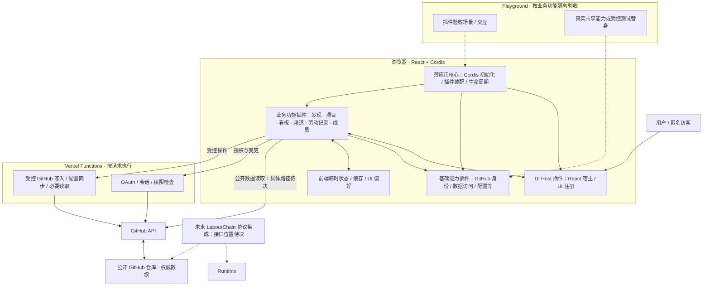

# Hackathon Platform — Architecture Map

> **状态：讨论草稿 v0.2（2026-10-25）**  
> **用途：** 先建立全局拼图，再按证据和用户决策填补空缺。本文不是已生效的工程规范，也不意味着建议模块已经实现。  
> **基线：** `Ri0n72Y/hackathon-platform` 的 `main` 分支、MVP 产品规格、Issues #1/#2/#5/#13、用户明确确认的全栈功能插件与 Playground 验收边界、Project Team v3。PR #14 不是用户确认的架构决定，不纳入此文档的决定性依据。

## 0. 标记方式

- **[约束]** 用户明确的产品或技术约束，或 MVP 规格已有明确规定的范围。
- **[现状]** 在当前 `main` 中已观察到的代码或文件；不表示生产验证通过。
- **[方向]** 当前采用的讨论方向，具体定义和验收标准尚待确定。
- **[待决]** 需要用户与 Architecture Steward 讨论后确定。
- **[待验证]** 需要代码实验、部署或专项研究支持，不能仅凭设计推断。
- **[后续]** 本轮不需要细化，不因此提前搭建基础设施。

## 1. 产品及运行边界

**[约束]** 平台面向黑客松团队和开源协作社区。MVP 通过公开 GitHub 仓库提供项目发现、Issue 看板、频道讨论和基础劳动记录。React 负责 UI；Cordis 负责插件及服务组织；Vercel 承载网页和 Functions；GitHub App 提供用户授权与仓库访问；GitHub 仓库是主要业务数据源；不建立传统在线业务数据库；保留 LabourChain 协议未来接入位置。

**[约束]** MVP 不包括私有仓库、PR 看板、跨平台 Git 适配器、持续后台同步、常驻 Worker、完整 LabourChain 协议或价值计算。产品规格所描述的 `labourchain.config.yaml`、`status:*`、`channel:*`、`CardItem`、`Asset` 和劳动记录属于已提出的产品/数据契约；不是已实现的代码模块。

**[约束·用户确认]** 将平台设计为**全栈业务功能插件的组合**。插件围绕一个完整、可验收的业务功能，而不是单个函数、组件或 API 操作；也不应同时吞并多个复杂且完整的业务模块。插件可以按需包含 UI、Cordis 服务、领域逻辑和服务端 Function，但前后端各自的代码与运行职责须保持可辨识，不能混成不可维护的大模块。

**[约束·用户确认]** 插件无需独立部署：MVP 统一部署平台。部分功能插件能在类似 Storybook 的 **Playground** 中运行；**每个业务插件都应能在 Playground 中按自身能力单独验收**。这一点指功能可隔离验证，不表示运行时必须零依赖，也不要求所有插件都提供独立可见页面。Playground 可通过明确的共享服务或受控测试替身提供前置能力。

**[约束·用户确认]** 采用**薄应用核心（Thin Core）+ 基础能力插件 + 业务功能插件**的责任划分：应用核心仅负责运行环境启动、Cordis Context 创建、插件装配与生命周期协调，不包含 GitHub 或看板等业务语义；UI 注册与 React 宿主、GitHub 身份接入、数据访问等可复用能力通过 Cordis 插件提供；业务功能插件消费所需服务并拥有各自的业务闭环。Playground 是另一种插件组合与验收入口，不是单独重写业务实现。

**[待决]** 一个逻辑功能插件是否对应独立包、Function 文件布局、如何组织 Playground 场景及如何验证真实 GitHub 写入，均不在此轮冻结。

## 2. 技术架构全局地图

这张图表示**逻辑边界**，不是部署拓扑的最终细节。**生产应用和 Playground 复用业务插件，而不是分开维护两套功能实现。** Playground 既能展示交互，也应能检查业务效果与失败路径；仅看到 UI 渲染，不等于一个依赖真实 GitHub 写入的闭环已经通过端到端验收。

### P1 全栈插件与 Serverless 运行边界（已确认）

**[约束·用户确认]** **浏览器端使用 Cordis 插件运行时，服务端使用普通 Vercel Functions**。MVP 不在 Functions 侧创建第二套 Cordis Context、插件装载与生命周期系统。当前 Serverless 的按请求执行模型不需要服务端动态插件组合；额外运行时会增加无需求支撑的启动与装配负担。

**[架构原则]** 一个“全栈业务插件”是按业务责任形成的**逻辑功能单元**，不是要求在前后端都运行 Cordis：浏览器中的 Cordis 插件提供服务和 UI；同一业务能力需要后端时，由普通 Function 入口承担认证、权限校验、GitHub 写入等服务端职责。相关领域解析和校验可在适用时复用普通 TypeScript 代码；是否放入同一包、Function 入口怎样组织，待实际功能落地时确定。前后端不共享运行时实例、Cordis Context 或浏览器状态。

**[现状]** 当前代码已经采用浏览器 Cordis + `api/*.mjs` Functions 的执行形式，但服务端文件与业务插件的逻辑归属仍未系统化整理；本决策确认目标边界，不把当前实现的文件布局视为最终标准。

**[后续]** 若未来真正出现需要服务端动态装载与替换插件的场景，应依据具体需求重新评估运行时；当前不为此建设基础设施。

## 3. 功能拼图（不是立即拆包清单）

| 功能区域 | 核心责任（高层） | 对照现状 | 状态 |
| --- | --- | --- | --- |
| Platform Core / Bootstrap | 创建 Cordis Context、装配与释放插件；不含业务逻辑 | `apps/playground/src/runtime.tsx` | [约束·用户确认] 薄核心；[现状] 基础原型 |
| React UI Host（基础能力插件） | 唯一 React 宿主及 UI 注册、组合 | `plugins/react-ui/` | [约束·用户确认] 归插件；[现状] 已有原型 |
| Playground / Acceptance Harness | 按业务场景单独装配插件并观察可验收行为，可按需使用可控依赖 | 现有 `apps/playground/` 目前是整体原型入口 | [约束] 需要插件级验收；场景设计 [待决] |
| GitHub Identity & Access | App OAuth、会话、权限与安装范围校验 | `api/github-login.mjs`、`github-callback.mjs`、`github-verify.mjs` | [现状] 局部实现；完整安全验收 [待验证] |
| GitHub Data Access | 仓库 / Issue / 评论 / Commit 的获取、分页、缓存与错误 | `plugins/repo-issues/`、`api/_github.mjs`、`issues.mjs` 等 | [现状] Issue 基础读取；访问边界 [待决] |
| Project / Repository | 仓库级页面、入口和挂载状态 | 当前仓库选择界面 | [方向]；挂载流程未完成 |
| Config & Label Management | 配置解析、校验、Label 初始化与同步 | MVP 规格中的数据契约 | [方向] 未实现 |
| Issue Board | Issue → CardItem、状态解析、看板和状态变更 | 当前为 Issue 列表与手动创建 / 评论 | [方向] 未实现完整看板 |
| Channels | 频道定位、展示及 Issue 评论 | MVP 规格定义 | [方向] 未实现 |
| Labour Records | 解析 Commit / YAML 评论、关联 Asset | MVP 规格定义 | [方向] 未实现 |
| Team / Members | 可选 `team-index/` 成员信息 | MVP 规格定义 | [方向] 未实现 |
| Discovery / Index | 从公共索引进入项目、项目卡片 | MVP 规格定义；#4 后置 | [方向] 未实现；具体索引契约 [待决] |
| LabourChain Integration | 后续正式协议集成边界 | MVP 明确不运行完整协议 | [后续] 只预留演进位置 |

**[约束·用户确认]** 功能模块沿纵向拥有自己的业务闭环与可验收行为；可依赖明确声明的共享能力。这里的功能区域不是一一对应的最终插件数，具体分合应由业务闭环、复杂度和可独立验收性共同决定。

### 3.1 插件边界的初步判断（已确认的原则，不是拆包清单）

- **合适的边界：** 例如“Issue 看板”能够加载任务、按状态展示并触发受控状态变更；可以在 Playground 中提供测试仓库数据与受控写入模拟，检验完整交互路径。
- **太细：** 仅为 `parseStatusLabel()` 或单个按钮包装 Cordis 插件；应优先作为业务插件内部的普通函数或组件。
- **太大：** 一个插件同时独立实现看板、频道、成员和劳动记录等多个完整业务领域；应检查其是否含有多个可单独验收的业务闭环。
- **独立验收 ≠ 零依赖：** 共享身份、数据访问等能力可以以真实实现或测试替身提供；插件不应为了 Playground 而复制整套平台。模拟验收与真实 GitHub/Vercel 集成验证应明确区分。

## 4. 平台核心与插件归属（P2 已确认）

**[约束·用户确认]** 应用核心只负责**让插件运行和组合**，而不直接提供 GitHub、看板或其他业务能力。基础能力与业务功能均通过 Cordis 插件提供，避免核心随着产品功能增长成为庞大模块。

| 层次 | 拥有什么 | 不应承担什么 | Cordis 插件？ |
| --- | --- | --- | --- |
| **Platform Core / Bootstrap** | 环境入口、创建 Cordis Context、装载插件、统一生命周期及退出清理 | GitHub 数据规则、身份业务、项目/看板等具体功能 | 否；它负责启动插件 |
| **Infrastructure Plugins** | 可复用平台能力，例如 React UI 注册宿主、GitHub 授权接入与数据访问 | 直接吞并具体业务闭环 | 是；按可复用能力组织，具体数量待实践确定 |
| **Feature Plugins** | 可在 Playground 独立验收的业务闭环，例如看板、频道、劳动记录 | 自建整套应用运行时，绕过共享服务重复实现认证/数据接入 | 是；以业务功能划分，避免过细或过大 |
| **Playground** | 选择性装配待验收插件及必要依赖，提供交互场景、测试替身与观察入口 | 复制正式应用的业务实现，或将模拟测试等同于生产集成验收 | 否；是应用装配与验收宿主 |

**[约束]** 基础能力插件可以没有独立用户页面，但应具备对其公开行为的可观察验收途径；领域内部普通函数、类型和 React 组件不因“插件化”原则而各自成为插件。业务插件可声明基础服务依赖；“独立验收”不等于“无依赖”。

**[现状]** `apps/playground/src/runtime.tsx` 已在应用入口构造 Cordis Context、挂载插件并逆序释放；`plugins/react-ui/` 提供 UI 注册能力；`plugins/repo-issues/` 提供部分数据服务。这些是当前设计的起点，不代表前后端已实现完整的插件化装配。`api/*.mjs` 当前承担部分 GitHub App OAuth、Issue 读取和用户身份写入；服务端的 Cordis 插件机制并不存在。

**DSH 参考边界。** [DeepSeek Harness 架构文档](https://github.com/deepseek-ai/deepseek-harness/blob/master/docs/architecture.md) 明确采用插件树、按配置组合能力，许多位于 `core/*` 的服务本身也是 Cordis 插件，并非特权业务单体；[Web Client 架构](https://github.com/deepseek-ai/deepseek-harness/blob/master/docs/subsystems/web-client.md) 也区分插件加载、服务、客户端模型和 UI 组合。这支持“薄启动层、功能由插件贡献”的组织原则。**但本项目不照搬 DSH 的 Profile/Bundle 系统、常驻 Host 或远程通信框架**：它们不是当前 MVP 的需求。这里的“Core”专指我们的最小应用引导层，不是照抄 DSH 仓库 `core/*` 的包名划分。

### P2b 插件依赖与公开契约（机制已明确，具体接口待落地）

**[已验证·Cordis]** 服务是以名称注册在 Cordis Context 上的能力；消费者通过 `inject` 声明**必需服务**，由运行时在依赖满足时激活。提供方消失时消费者会卸载，并在服务恢复后重新激活；**不通过启动列表顺序解决依赖**。可选能力不列为硬依赖，应在使用时判断其是否存在。服务注册、监听器与子插件卸载由 Cordis 生命周期管理，额外的计时器、网络请求、外部订阅等副作用在插件作用域内明确清理。上述属于已有框架机制，不再自建依赖容器、插件状态机或卸载协议。

**[架构原则]** 消费插件只依赖其使用的**公开能力契约**（方法、数据类型、可观察状态），不通过运行时导入另一插件的具体实现来协同。TypeScript 可通过 `import type` 共享提供方导出的公共类型；`Context` 声明合并提供编译期提示，运行时仍需由 Cordis 满足服务依赖。**不要仅为类型预先建立独立的通用 `contracts` 包**；出现多个真实提供方或跨运行时复用需求时再评估抽离契约。服务之间应避免循环硬依赖：如发现循环，先检查业务职责是否缠绕、能力边界是否放错，而不是增加第二套事件总线或服务定位器绕过依赖关系。

**[架构原则]** 插件激活成功与业务数据已就绪不是同一个状态。需要可观察数据时，服务自身负责状态、订阅及更新；React 界面通过服务的快照/订阅接口观察变化，不以组件局部状态作为共享业务真相。只有真正跨插件消费的行为才需要成为服务；普通业务函数与组件仍可留在拥有它的插件内部。

**[约束·Playground]** Playground 按需要装配**被验收插件 + 声明的依赖**。对网络、授权等外部边界可以提供符合公开契约的受控替身，验证功能的成功、失败和生命周期行为；基础能力插件也可以通过操作/状态检查验收，不强制有可见的业务页面。应明确记录哪些结果来自替身、哪些来自真实 Vercel / GitHub 组合，避免把单插件验收报告为端到端验证。场景格式、目录和具体装载器暂不冻结。

**[现状与差距]** `repo-panel` 已声明 `inject: ['reactUI', 'repoIssues']`，并将 UI 注册撤销交由 `ctx.effect()`；`repo-issues` 通过 `getSnapshot/subscribe` 提供可观察状态。与此同时，`repo-panel` 和其 Issue 工作区仍直接发起部分 `/api/github-*` 请求；仓库目前没有单插件场景目录与独立验收装载能力。这是需要逐步演进的**现状差距**，不应描述为插件化已全面完成。

**[后续细化]** 具体服务名称、接口类型、错误/取消模型、插件包布局、是否需要多 UI 区域，以及跨浏览器与 Vercel Functions 的契约边界，都要在对应功能实现或专项调研时确定；这里不设计假想通用协议。

**来源：** [Cordis 服务与 `inject` 教程](https://github.com/deepseek-ai/deepseek-harness/blob/master/docs/cordis-tutorial/03-services.zh.md)、[生命周期与 effect](https://github.com/deepseek-ai/deepseek-harness/blob/master/docs/cordis-tutorial/02-lifecycle-and-effects.zh.md)、[React + Cordis 技术指南](https://github.com/Ri0n72Y/agent-identity/blob/main/library/react-cordis.md)。

### 尚未确定的技术边界

- **[已确认]** Functions 侧不运行 Cordis；**[待决]** API 端点在仓库中的组织、所属业务插件如何维护服务端处理逻辑，以及哪些纯领域代码适合跨运行时复用。
- **[已验证]** Cordis 已提供必需服务注入、依赖卸载与生命周期；**[待决]** 具体公共服务接口、缓存/刷新、路由、跨运行时与 UI 扩展点归属。
- **[约束]** Playground 可按业务功能隔离验收；共享依赖可以提供真实实现或受控替身，必须区分模拟路径与真实 GitHub/Vercel 集成验证。
- **[待验证]** 实际 Vercel 部署、会话失效、权限与安装范围、多仓库访问、GitHub 限流及并发修改。

## 5. 三类主数据流（先确定有这三类）

1. **公开读取：** 用户进入公开项目 → 获得 GitHub 原始数据 → 解析配置/领域模型 → React 渲染。可在客户端读取公开数据，也可能因实际限制由受控 Function 读取；具体分配 [待决]。当前代码以 Function 的安装令牌读取为主 [现状]。
2. **用户写入：** 用户执行明确操作 → 同源 Function 检查会话、目标与权限 → 用 GitHub App 用户令牌请求 GitHub → 回传结果并修正 UI。不得将服务端秘密下发浏览器 [约束]；当前 Issue 创建/评论具备这条链路的部分实现 [现状]。
3. **仓库挂载/配置同步：** 维护者授权 → 读取与校验配置、仓库权限 → 执行受控 Label/配置操作 → 返回逐项状态与失败信息。MVP 规定同步不是原子事务 [约束]；实际闭环尚未实现 [待验证]。

## 6. 第一批未完成拼图

| 决策 / 实验槽位 | 当前问题 | 本轮处理方式 |
| --- | --- | --- |
| **P1 全栈插件与 Serverless 运行边界** | **已确认**：浏览器 Cordis 插件 + 普通 Vercel Functions；业务插件是完整逻辑功能单元，不要求两端各运行 Cordis；部署统一。**待细化**：服务端文件归属和跨运行时代码布局 | **已填写第 2 节**；不建立第二套服务端插件运行时 |
| **P2 平台核心与插件的归属** | **已确认**：最小启动/装配核心不是插件；UI 宿主、GitHub 接入/数据等基础能力及各业务闭环通过 Cordis 插件提供；Playground 是验收入口 | **已填写第 4 节**；不再将原则性划分作为待批准问题 |
| **P2b 插件依赖与公开契约** | **已验证**：Cordis `inject` 与生命周期承担运行依赖；插件通过公开服务协同，Playground 用依赖组合/受控替身验收；**待细化**：具体接口和场景格式 | **已填写第 4 节**，不引入第二套依赖框架 |
| P3 GitHub 读取与缓存边界 | 浏览器直连、Function 代理如何按场景划分？ | 结合现状与安全/速率实验 |
| P4 身份与写操作边界 | 多仓库安装、权限、会话与幂等如何验收？ | 复用 #5 研究，补真实验证 |
| P5 项目领域模型与配置 | Repo / CardItem / Channel / Labour / Asset 的契约如何落地？ | 按首个真实功能分段细化 |
| P6 AI 开发与检查机制 | 项目级规则、技能引用、CI 和 Review 如何配合？ | 先确立架构，再变成可执行规范 |

## 7. AI 开发资料的正确层级

**[方向]** `docs/architecture.md` 将作为项目架构事实、已批准决定和未决问题的入口之一；后续 `AGENTS.md` 可作为简短导航和操作指引，而不是复制整份架构。只有经过明确确认的规则才转入有约束力的规范。

`Ri0n72Y/agent-identity` 的资料按用途引用，不视为项目自身规范：

- `library/react-cordis.md`：React / Cordis / 插件装配的技术参考。
- `library/function-first-cordis-plugin-programming.md`：服务状态、纯逻辑与生命周期的编程参考；不强制禁用类。
- `.agents/skills/project-team/`：持续角色和 GitHub 交接（已与用户上传的 Team v3 核对）。
- `.agents/skills/ponytail/`：实现任务减少无用抽象的参考。
- `.agents/skills/dependency-risk-testing/`：从实际依赖风险选择测试的参考。
- `.agents/skills/ralph/`：需要边界清楚的工程任务时采用的任务/报告契约，不另建任务系统。

Core / Soul / Principles 属于通用身份或方法层，不应替代项目自有的架构与约束。外部技能是否被 AI 工具自动加载，需要按实际工具验证，不能仅凭仓库存在而假定。

## 8. 后续工作节奏

**先对齐地图（包含 Playground 验收角色）→ 逐个填 [待决] → 小实验验证 [待验证] → 将经确认的决定转成具体约束和测试 → 通过独立分支/PR 提交，交由 Lead 与用户确认。** 已具备可靠依据、属于常规技术判断的内容直接标注来源并填入文档；仅当存在实质架构取舍、证据冲突或超出既定约束的决定时，才单独请求用户判断，避免形式性的逐项确认。

本文仅提交架构讨论草稿，不修改业务代码，也不直接改变 `main`。合并及后续规范化需要 Lead 与用户确认；现有 Issues 和 PR 是工作事实的唯一 GitHub 记录位置，不另建影子任务板。

## 依据（截至 2026-10-25）

- [MVP 产品规格](https://github.com/Ri0n72Y/hackathon-platform/blob/main/docs/LabourChain-MVP-Product-Spec.md)
- [当前代码：apps/](https://github.com/Ri0n72Y/hackathon-platform/tree/main/apps)、[plugins/](https://github.com/Ri0n72Y/hackathon-platform/tree/main/plugins)、[api/](https://github.com/Ri0n72Y/hackathon-platform/tree/main/api)
- [Issue #1 技术调研](https://github.com/Ri0n72Y/hackathon-platform/issues/1)、[#2 项目页面](https://github.com/Ri0n72Y/hackathon-platform/issues/2)、[#5 GitHub 授权研究](https://github.com/Ri0n72Y/hackathon-platform/issues/5)、[#13 Team Index](https://github.com/Ri0n72Y/hackathon-platform/issues/13)
- 用户上传的 `SKILL - team v3.md`；[agent-identity](https://github.com/Ri0n72Y/agent-identity)
- [DSH 架构文档](https://github.com/deepseek-ai/deepseek-harness/blob/master/docs/architecture.md)、[Web Client 架构](https://github.com/deepseek-ai/deepseek-harness/blob/master/docs/subsystems/web-client.md)（用于验证薄启动层和插件贡献能力的架构边界；不是照搬其部署结构）
