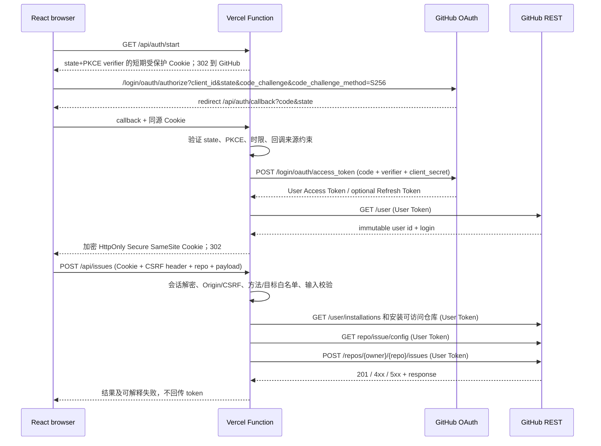

# GitHub App 用户授权与安全写入链路研究

状态：Research draft；2026-10-21。关联：#5、#1。**未创建测试 GitHub App，未进行真实 API 写入。**
本报告将「官方文档验证」「Connector 行为观察」「工程建议」「待 PoC」分开。遵守 MVP：React + Cordis、Vercel 静态站与 Functions、GitHub 公开仓库、只处理 Issue、不依赖在线业务数据库。

## 1. 核心结论与边界

**已由 GitHub 官方文档确认**：App JWT 表示 App 自身；Installation Access Token 表示安装，操作归属 App；GitHub App User Access Token 表示授权用户，API 操作归属用户。User Token 访问权由用户权限、App 权限及 App 安装所授权的仓库共同约束。仅用户授权不等于 App 已安装在目标仓库。GitHub 可因组织政策、SSO 等额外限制拒绝操作。来源：[认证身份](https://docs.github.com/en/apps/creating-github-apps/authenticating-with-a-github-app/about-authentication-with-a-github-app)、[代表用户](https://docs.github.com/en/apps/creating-github-apps/authenticating-with-a-github-app/authenticating-with-a-github-app-on-behalf-of-a-user)。

**推荐**：交互式写入仅使用 User Access Token。Function 作为受限、目标固定的操作接口，不能作为任意 GitHub API 代理。安装令牌仅在未来有明确需要的非用户自动化时单独评审，不用于绕过用户权限。最小首闭环：授权→建立会话→GET /user→GET /user/installations 和安装仓库列表→验证目标 Issue→POST Issue→确认 author 与授权用户一致。

## 2. 授权及首次写入时序（设计建议，待实际 PoC）

GitHub Web Application Flow 支持 `state`、PKCE S256 和服务端 code 交换。必须先核对 `state` 再交换；严禁将 client secret、access token、refresh token 或私钥暴露给浏览器 JS。[GitHub 生成 User Token](https://docs.github.com/en/apps/creating-github-apps/authenticating-with-a-github-app/generating-a-user-access-token-for-a-github-app)。

App 安装与用户 OAuth 授权是两条独立许可；用户可在 GitHub 安装 UI 选全部或特定仓库。建议在授权成功后为目标仓库做明确的安装范围核对，不依赖浏览器上送的 installation_id；动态校验 `/user/installations` 及 `/user/installations/{installation_id}/repositories`，并由最终写入 API 强制执行权限。[安装与用户权限](https://docs.github.com/en/apps/creating-github-apps/authenticating-with-a-github-app/generating-a-user-access-token-for-a-github-app)。

## 3. 无数据库会话比较

| 方案 | 机密性与撤销 | 成本 / UX | 结论 |
| --- | --- | --- | --- |
| 服务端加密且认证的 Cookie（AEAD）装 User Token、可选 Refresh Token、用户 ID、会话版本与到期时间 | HttpOnly/Secure/SameSite、AAD 绑定用途；浏览器无法用 JS 读取；Cookie 被盗仍可重放，不能即时全局吊销 | 无数据库；Cookie ~4KB 上限（编码后空间更少）；每次请求上传；双请求并发刷新可能损坏会话 | 推荐短期 PoC；需要实际测大小及刷新竞态 |
| 签名但不加密的 Cookie/JWT | Token 明文可见，不能用于存放 GitHub Token | 简单 | 拒绝 |
| 仅 Function 内存存 Token | 冷启动、实例切换时失效；无法保证会话 | 不可靠 | 拒绝作为唯一存储 |
| 短会话 Cookie 仅存短期 User Token，到期重走 OAuth | 减少持有刷新令牌的生命周期；会话不可主动服务端撤销 | 8 小时后重授权；并发简单 | 安全优先的 MVP 候选，建议与上方案 PoC 对比 |
| 浏览器 localStorage 存 Token | 暴露于 XSS | 看似容易 | 拒绝 |

推荐同源部署：静态网页及 `/api/*` 同域；Cookie `__Host-...`、`Secure`、`HttpOnly`、`Path=/`、明确 SameSite=Lax 或 Strict；限制可访问路径和 TTL。写入时核对 Origin，增加独立 CSRF token（绑定会话，不仅依赖 SameSite）；CORS 默认关闭；禁止重定向到非白名单回调。Cookie AES-GCM 密钥保存在 Vercel Server-side Environment Variables，支持 key-id 轮换；禁止打日志、缓存 Cookie/token。Vercel 环境变量更新仅对新 deployment 生效，部署切换时需规划旧密钥兼容。[Vercel 环境变量](https://vercel.com/docs/environment-variables)。

**重要结构性限制（推断）**：GitHub 一次刷新后旧 access token 和旧 refresh token 都失效。两个无共享状态的 Functions 从相同 Cookie 同时刷新，可能一成一败，且较晚响应覆盖新 Cookie。无法只凭无状态 Cookie 保证一次性刷新锁或即时撤销。可先选短期会话、到期重新授权；若保留 refresh token，必须串行化前端刷新并在服务端识别失败后重授权，但多标签页/设备竞争仍未彻底解决。不得声称纯无状态设计有强撤销保证。[刷新文档](https://docs.github.com/en/apps/creating-github-apps/authenticating-with-a-github-app/refreshing-user-access-tokens)。

GitHub 官方当前文档说明 expiring user token 通常有效 8 小时，refresh token 6 个月；刷新使用 `POST /login/oauth/access_token` 和 `grant_type=refresh_token`，成功后旧刷新令牌和旧访问令牌失效。App 过期功能可配置；PoC 需记录实际配置与 response 中期限。[官方刷新说明](https://docs.github.com/en/apps/creating-github-apps/authenticating-with-a-github-app/refreshing-user-access-tokens)。

退出：清除会话 Cookie，解释无状态方案无法立即吊销被复制的 Cookie。可按产品决策再调用 GitHub 撤销 token / grant API，但会影响其他会话。用户也可在 GitHub Settings → Applications → Authorized GitHub Apps 撤销授权；后续 User Token API 返回 401。无 Webhook 常驻处理时靠请求时检测；不承诺即时全局登出。[撤销授权](https://docs.github.com/en/apps/using-github-apps/reviewing-and-revoking-authorization-of-github-apps)。

## 4. 操作与权限矩阵

| 操作 | REST 请求 | 最小 App Repository permission | 服务端特殊校验 |
| --- | --- | --- | --- |
| 创建 Issue | POST /repos/{owner}/{repo}/issues | Issues: write | 确认公开仓库已安装 App、User Token 有权；只允许配置中目标仓库；必要时先检查 Issues enabled |
| 评论 Issue | POST /repos/{owner}/{repo}/issues/{n}/comments | Issues: write | GET 目标 Issue 并确认 **没有 pull_request 字段**；防止向 PR 写评论 |
| 新增 status label | POST /repos/{owner}/{repo}/issues/{n}/labels | Issues: write | 校验唯一允许的 status 值、原 Issue 的全部标签及非 PR |
| 移除旧 status label | DELETE /repos/{owner}/{repo}/issues/{n}/labels/{name} | Issues: write | 仅删 status: 命名空间；不可使用覆盖全部 Labels 的操作 |
| 读取配置 | GET /repos/{owner}/{repo}/contents/labourchain.config.yaml | 公开仓库可匿名读取；如授权读则 Contents: read | 只允许根目录指定文件；schema 校验；禁止路径注入 |
| 更新配置 | PUT /repos/{owner}/{repo}/contents/labourchain.config.yaml | Contents: write | 读当前 sha 后带 sha 写入；确认用户具备仓库实际写权限、分支保护、配置 Schema、目标默认分支 |

官方来源：[Issues](https://docs.github.com/en/rest/issues/issues)、[Comments](https://docs.github.com/en/rest/issues/comments)、[Labels](https://docs.github.com/en/rest/issues/labels)、[Contents](https://docs.github.com/en/rest/repos/contents)。

配置更新失败必须保留 GitHub 原值；遇到 SHA 不一致/409/422 应重新读取、向用户提示冲突，而不是盲覆盖。需要注意 GitHub 的 Labels API 有 `PUT .../labels` 全量替换，**不得**用于状态拖动，因为它会覆盖非 status Labels。Add/Remove 属于多个请求，不构成原子操作；并发状态拖动需要读后复核和冲突检测，仍无法保障跨请求原子性；MVP 可在 UI 层禁止重复提交，并在完成后重新获取权威 Issue。

Issue REST endpoints 可能包含 PR；不要仅通过 `issues/{n}` 路径证明目标是 Issue。检查 `pull_request` 键是范围限制所必需。维护者挂载权限与通常 Issue 参与权限不同：挂载建议另外通过 authenticated `GET /repos/{owner}/{repo}` permission、collaborator permission API 或 GitHub 原生权限能力验证，并以实际接口测试证明所需身份阈值；不要凭成员名称映射 Owner/Maintainer。

权限失败处理：401 → token 过期/撤销，刷新或重新授权；403 → 用户/App/组织策略/速率限制等，读取 response 和 rate-limit headers；404 → 资源不存在或访问不可见，不能强行区分；409/422 → SHA 冲突、validation 或 abuse；429/secondary limit → 遵守 retry-after/backoff，避免盲目重复 POST。Issue 创建、评论不可天真假定幂等，网络超时后先回读确认后再决定是否重试。

## 5. Connector 可观察对照

**本次通过当前连接实际观察**：可读取目标公开仓库、MVP 文档、Issue #1/#5；连接暴露仓库安装列表、仓库/Issue 读取及 create_issue、add_comment_to_issue、create_file 等写入动作。已显示当前用户的 GitHub 登录，以及账号可见的安装信息和 `repository_selection`。**没有发起生产写入**，因此没有验证写操作最终显示的 GitHub actor。

**官方参考**：GitHub 安装流程允许选择全部仓库或指定仓库；用户授权与安装是独立操作。OpenAI 的 GitHub Enterprise App 配置文档描述安装、选择仓库、用户连接、App 权限以及读写 action control，但不能证明普通 ChatGPT/Codex 连接使用同一实现。[GitHub App 使用](https://docs.github.com/en/apps/using-github-apps/about-using-github-apps)、[OpenAI GitHub Enterprise App](https://help.openai.com/en/articles/20001248-set-up-the-github-enterprise-app-template-in-chatgpt/)。

**未知**：Connector 私有服务端架构、令牌加密方式、refresh 协调、具体写入所用 token 类型、授权提示的完整 UI、对外权限是否与 UI 完全一致。不可据此复制内部实现。

## 6. 可复现的最小 PoC（尚未执行）

前置条件：Lead 批准后新建隔离的公开测试仓库，创建测试 GitHub App；仅请求 Issues:write，按需加入 Contents:write；开启过期 user tokens。至少准备：仓库写权限用户 A、只读/无权用户 B、安装包含/排除仓库的测试条件。

验收用例：
1. A 经 OAuth Web Flow + state + PKCE 登录，Function `GET /user` 确认其 numeric id；成功创建一条测试 Issue，GitHub UI/REST 的 author 为 A（并记录 App badge），HTTP 201。
2. B 同样授权后试写 A 允许的仓库，必须由 GitHub 权限控制拒绝；Function 不能回退到 Installation Token。
3. 将目标仓库从 App installation 的 repo selection 中移除，再试写：拒绝。
4. OAuth callback 缺少、篡改或重放 state、缺少 verifier：拒绝，不创建会话。
5. 跨站 POST、缺少 CSRF、跨 repo 参数、PR number 伪装成 Issue：拒绝。
6. 人为令牌过期、GitHub 撤销授权：不允许操作；按设计要求重新授权。
7. 两标签页同时刷新：观察单次使用 refresh token 的竞态；如不可可靠协调，MVP 启用到期重新登录策略。
8. 配置更新用旧 SHA：报告冲突，不能覆盖新数据。
9. 两个状态更新并发：验证可能非原子、结果重新读取；不改动其它命名空间。
10. 模拟 GitHub 403/404/422/429、网络超时：前端回滚乐观 UI，不重复无条件 POST。
11. 对照小于 4KB 的 Cookie 实际尺寸与浏览器限制、Vercel 冷启动/多实例、key rotation。

每一用例记录 request 方法与 path（不记录 token）、响应状态、actor、错误信息、环境和复现步骤。PoC 结果通过独立 PR 更新本研究文档，不在真实项目仓库写业务 Issue。

## 7. 交给 Lead 的决策点

1. 会话优先 **到期重授权**（减小无状态刷新竞态）还是 **加密 Cookie 持久 refresh token**（较好 UX、竞态和泄漏影响更大）？
2. 仓库配置变更是否允许直接更新受保护默认分支？如果默认分支有 branch protection/ruleset，则必须明确可行权限和冲突 UX。
3. 状态 Label 多请求非原子：MVP 是否接受最终一致与刷新确认，或需要收紧状态变更并发策略？
4. 仓库挂载的 Owner/Maintainer 权限阈值如何根据实际 GitHub API 转换成可复现的校验？

本报告不等于端到端 PoC 已成功。**已验证**的是 GitHub 官方协议和端点权限声明；**尚未验证**的是 Vercel 部署行为、真实 OAuth 回调、cookie 长度和实际写入 actor。
