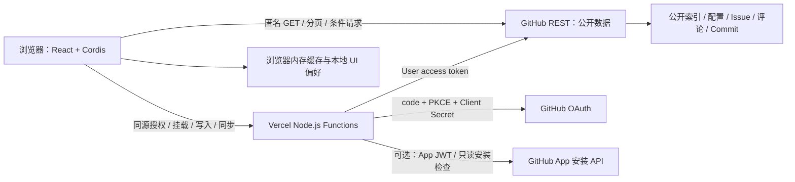
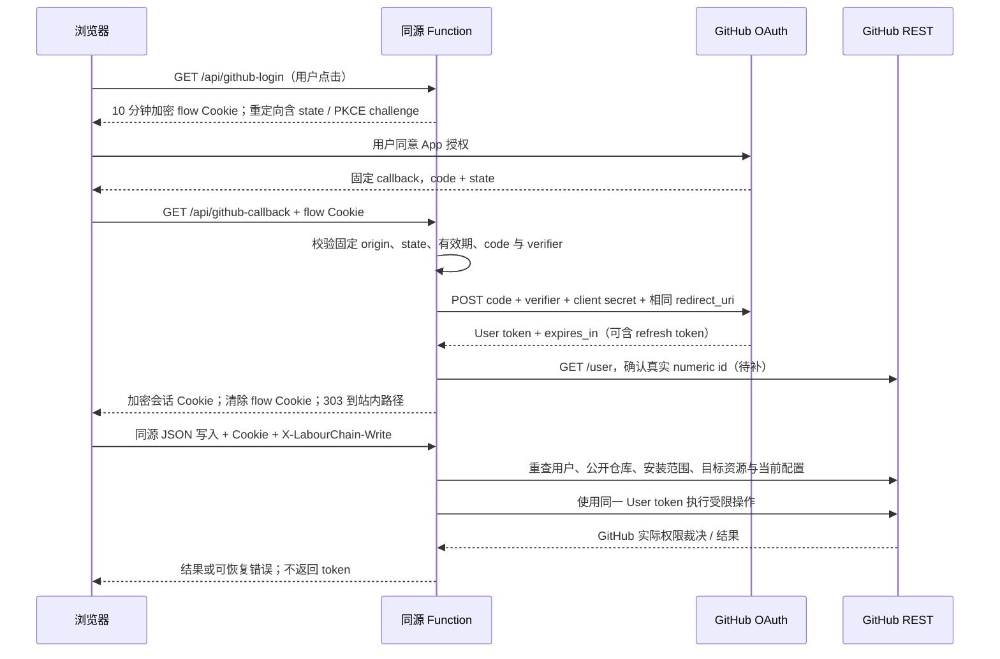

# LabourChain MVP 技术栈与 GitHub App 授权方案

日期：2026-10-25。对应 [Issue #1](https://github.com/Ri0n72Y/hackathon-platform/issues/1)。范围依据：[MVP 产品说明](./LabourChain-MVP-Product-Spec.md)。仓库现状基线：`595b9f9`。

本次交付为文档研究，不新增产品代码，不注册 App、不部署、不执行真实授权或 GitHub 写入。下文“推荐”是实施方案，“现状”是代码阅读结果，官方能力与尚待验证的假设分别标注。本文汇总并更新两份历史研究，后续实施以本文与产品规格为入口。

## 1. 产品目标、范围与推荐结论

LabourChain 是面向黑客松团队的仓库级协作入口：发现项目 → 进入公开仓库 → 用 Issue 看板组织任务、用频道 Issue 的评论讨论 → 从 Commit 与结构化评论展示可追溯的劳动记录。GitHub 保留真实任务、文件与讨论数据；平台提供更易参与的界面。

推荐沿用 **React 19 + TypeScript + Vite + 当前锁定的 `@deepseek-ai/cordis@4.0.4`**。React 负责视图，Cordis 负责模块、服务注入和插件生命周期，Vite 构建静态资源；Vercel 托管 `dist/` 与按请求触发的 Node.js Functions。公开数据以浏览器直接读取为主；凭据、授权、挂载检查、写入与配置同步由同源 Functions 处理。无需切换 Next.js 或引入常驻应用服务器。

首版包括：公共索引项目发现、公开仓库挂载、根配置解析、Issue 看板、频道、创建/评论/状态更新、Label 初始化和同步、浏览器缓存与刷新、基础劳动记录、可选成员目录。排除私有仓库、PR 看板、其他 Git 平台、业务数据库、服务端共享缓存、持续 Webhook 同步、常驻 Worker、价值计算和完整劳动链协议。

[Issue #3](https://github.com/Ri0n72Y/hackathon-platform/issues/3) 提出的 Topic 搜索不替代产品规格中的公共索引；作为另一个方案任务处理，本任务不将其纳入首页必需链路。规格提到的“现有 Board”未出现在本仓库，复用前需取得源码及版本，不能宣称已接入。

## 2. 仓库现状与差距

| 当前文件 | 阅读结论 | 到 MVP 尚缺 |
| --- | --- | --- |
| `apps/playground/src/runtime.tsx`、`plugins/react-ui/` | Cordis 注册服务，React 通过 `useSyncExternalStore` 订阅；按 Fiber 逆序释放插件 | 页面路由、运行时卸载/HMR 接线、请求取消 |
| `plugins/repo-issues/`、`plugins/repo-panel/` | 已有仓库选择、Open Issue 列表、详情、创建和评论界面 | 领域模型、配置、看板、频道、劳动记录、成员 |
| `api/_github.mjs`、`repos.mjs`、`issues.mjs`、`github-issue.mjs` | 安装令牌读取公开仓库；Issue 列表及评论仅首 100 条，列表过滤 PR | 浏览器公开读取、分页、索引、缓存、限流完整反馈 |
| `api/github-login.mjs`、`github-callback.mjs`、`_oauth.mjs` | state + PKCE；AES-256-GCM 加密 Cookie；最长 8 小时，不保存 refresh token | 回调后立即核验 `/user`、退出/撤销处理；真实 OAuth 链路不能由代码存在推定成功 |
| `api/github-session.mjs`、`github-verify.mjs` | 前者仅检查本地会话；后者请求 `/user` 并核对固定安装可访问仓库及权限字段 | `authenticated: true` 不证明令牌尚未撤销；没有维护者挂载接口 |
| `api/_issue-interaction.mjs`、创建/评论接口 | 限定同源 JSON 和自定义请求头；检查固定安装范围；写入使用用户令牌，评论拒绝 PR | 每次校验当前公开性/配置的统一流程、Label 操作、动态多安装、完整错误映射 |
| `vite.config.ts`、`package.json` | Vite root 为 `apps/playground`，输出仓库根 `dist`；React 19、Cordis 固定版本；无 lockfile | 可复现依赖锁定、部署配置、SPA 深链接与 `/api/*` 分流 |

两份 10 月 21 日研究中的“只有文档、没有工程实现”已经过时。Issue #7 的历史实验描述以及 #12 的测试 Issue 不能单独证明当前部署、令牌类型或失败路径已经验收。

## 3. 架构与运行职责

| 层 | 职责与边界 |
| --- | --- |
| 浏览器 | 读取公开索引、仓库、配置、Issue/评论/Commit；验证配置用于显示；缓存和派生视图；不持有明文 GitHub 令牌，不作为权限裁决方 |
| Cordis | 服务依赖、插件挂载/卸载、事件与副作用清理；不自动提供路由、React 渲染、查询缓存或构建工具 |
| Vercel Functions | OAuth、会话解密、用户/仓库/配置再校验、受限写入与同步；仅处理明确定义的操作，不做任意 GitHub URL 代理 |
| GitHub App | 注册权限、回调与安装仓库范围；不是单独运行的应用服务器 |
| GitHub OAuth / API | 签发/撤销令牌、保存数据、执行最终访问控制；请求仍受组织策略、仓库设置及分支规则限制 |

### Cordis、路由、状态与构建的组合

当前依赖是 DeepSeek 分支的 Cordis，不能把其他版本的 `Context` API 当作同一契约。按仓库版本使用 `Context`、`Service`、`inject`、`ctx.effect()` 与 `ctx.plugin()` 返回的 Fiber；通过 Fiber 的 `dispose()` 释放注册和副作用。官方项目文档说明这些机制，但不能代替本项目浏览器和部署验收。[C1]、[C2]

建议按功能逐步扩展现有目录：授权服务、仓库数据服务、配置与纯领域逻辑、看板/频道/劳动记录视图；只有出现独立职责时才拆插件，不先建立大量空包。纯 TypeScript 模块负责配置与命名空间、卡片有效性、频道选择、劳动记录解析，浏览器和 Function 共用。

路由推荐后续加入 React Router 的浏览器路由，统一管理 `/`、`/{owner}/{repo}`、`/{owner}/{repo}/issues/{number}` 及仓库下的看板/频道等路径。Cordis 管理相关服务，React Router 管理 URL、历史导航和视图选择。服务用不可变快照 + `useSyncExternalStore` 提供共享状态，表单和局部选择保留在 React；不额外引入全局状态库。数据服务负责分页、缓存、请求合并、过期请求取消和版本判断。

Vercel 导入时 Root Directory 选择**仓库根目录**，构建 `npm run build`、输出 `dist`；`api/` 与前端同域。`export default { fetch(request) }` 与 `.mjs` 是当前官方支持的 Node.js Function 形式。[V1] `npm run dev` 只启动 Vite，不会执行根 `api/`，本地完整链路需 Vercel CLI 开发环境。后续配置 SPA fallback 时必须保留 `/api/*` 与静态资源匹配，直接刷新 Issue URL 应返回应用，API 404 应仍是 API 响应。[V2] Function 超时和数量上限随实际套餐核实，不假设无上限；共享服务端辅助文件宜移至 `api/` 外。[V4]

### 无数据库的持久化与挂载

- 项目是否被首页收录由部署指定的**公开索引文件**决定，不等于某位用户的 OAuth 仓库列表；读取索引不要求登录。
- 项目配置、Issue、评论、Commit 和可选 `team-index/` 是 GitHub 上的持久化来源；不另建业务影子库。
- 推荐将“挂载”定义为：维护者身份与 App 安装范围已核实，仓库公开且配置有效，初始化同步成功。它不自动写入首页索引。重新进入项目时按需复核，不依赖 Function 内存中的“已挂载”标记。
- 挂载已有配置时不写文件；没有配置时展示默认配置预览，由维护者明确触发初始化。同步部分失败时显示“尚未完成”及逐项结果，不能给出完整成功标记。
- 首页索引更新是索引维护者的独立动作；不能以目标仓库维护权限推定可以写平台索引仓库。索引路径及格式由后续契约任务确定。

## 4. GitHub App 注册与环境配置

按 [GitHub 注册指引][G1]：

1. 在 Settings → Developer settings → GitHub Apps 新建 App；实验与生产建议不同 App，填写主页与稳定域名。
2. 设置用户授权回调 `https://<稳定域名>/api/github-callback`；授权请求与交换 code 使用相同的已登记 URL。安装 Setup URL 与 OAuth callback 是不同用途，安装回跳参数不能替代用户授权。
3. 保持 **Expire user authorization tokens** 开启；网页采用 Web Application Flow + PKCE S256，Device Flow 不需要。安装时是否顺带请求用户授权不影响两项许可仍须分别核实。
4. 权限申请 `Metadata: read`、`Issues: read & write`。读公开内容可匿名，不强制增加 Contents 权限；只有平台内初始化/更新配置时增加 `Contents: read & write`。不申请 PR、组织管理或 Webhook 写权限。
5. 不使用 Webhook 持续同步，关闭主动 Webhook 配置；撤销状态通过后续 API 请求检查，不承诺实时接收或处理事件。
6. 单账号实验可限制安装账号；面向其他团队时允许相应账号安装，并支持发现多个 installation。安装时优先只选所需公开仓库；安装范围变化及权限升级均需重新核验/批准。
7. 保存 Client ID、Client Secret。仅在使用 App 身份安装发现或现有安装读取实验时生成私钥并保存 App ID。用户 OAuth 换令牌本身不需要 App 私钥。

| 变量 | 使用端 / 说明 |
| --- | --- |
| `GITHUB_APP_CLIENT_ID` | 服务端；构建 OAuth URL、交换 code |
| `GITHUB_APP_CLIENT_SECRET` | 服务端秘密；交换 code、需要时撤销 token |
| `GITHUB_OAUTH_CALLBACK_URL` | 服务端；完整 HTTPS 回调，当前实现固定路径 `/api/github-callback`，不从 Host 请求头推导 |
| `GITHUB_OAUTH_COOKIE_KEY` | 服务端秘密；密码学随机 32 字节的无填充 base64url，供 AEAD 加密；不同环境隔离 |
| `GITHUB_APP_ID`、`GITHUB_APP_PRIVATE_KEY` | 可选安装管理/当前安装读取实验；私钥仅服务端，保留 PEM 换行；用户写入不得依赖 Bot 兜底 |
| `GITHUB_INSTALLATION_ID` | 当前实验固定安装；多团队接入需改为服务端动态发现，不信任前端传入值 |
| `VITE_PROJECT_INDEX_OWNER/REPO/REF/PATH` | **建议新增，当前代码没有**；公开索引定位，允许进入客户端，禁止放秘密 |

本地通过 `.env.local` 或 Vercel CLI 获取 Development 配置，禁止提交；Preview / Production 在 Vercel 环境设置分别配置，修改后重新部署。[V3] 当前代码强制 HTTPS 和 Secure Cookie，本地完整登录应使用可信 HTTPS 且回调已登记的固定开发地址；普通 HTTP Vite 只用于界面开发，不假设 Cookie 流程可用。随机 Preview 域名不能自动成为合法回调，推荐稳定测试域名与独立 App。Vercel 部署保护也不能阻断 OAuth 回调。

## 5. 用户授权、令牌类型与每次请求的权限

### 为什么使用 User access token

| 凭据 | 身份及限制 | 本 MVP 用法 |
| --- | --- | --- |
| GitHub App User access token | 代表用户；App 权限、安装资源范围、用户实际权限共同限制 | 所有交互式业务写入；最终由 GitHub API 授权 |
| Installation access token | 代表 App Bot；有效期约 1 小时，不代表访问网页的用户权限 | 可选受限安装检查/历史只读实验，不用于用户业务写入兜底 |
| App JWT | 代表 App；短时签名，不能直接承担普通 Issue 操作 | 换安装令牌、App 级安装发现 |
| PAT | 用户人工创建和分发，生命周期与权限不由本 App 用户授权流程统一管理 | 不作为产品登录或共享服务凭据；开发工具的 PAT 不证明 App 授权成功 |

GitHub 明确用户令牌不能给用户增加访问能力。[G2]、[G3] 这可以满足“按用户权限写入”，但不能保证用户期望的操作一定成功，也不能替代产品限制：挂载阈值、公开仓库、非 PR、受管 Label 都仍需服务端校验。普通用户创建/回复公开 Issue 不应被额外要求 `push`；修改 Label 则可能需要 triage 或更高能力，统一由最终接口判断。

### 授权与回调流程

state 用密码学随机数，绑定发起浏览器的短期加密 Cookie，恒定时间比较；PKCE 使用随机 verifier 与 SHA-256 challenge。缺失/篡改/过期 state、拒绝授权、无 code、交换失败均不建立新会话，并清理 flow Cookie。GitHub code 有效期短且不可重复使用；无状态 Cookie 的删除不构成全局 nonce 已用表，不能承诺任意被盗 flow 的一次性消费。[G3]

回调只能来自配置的固定部署 origin；不能凭 Referer/Origin 头判断“来自 GitHub”（正常跨站回跳未必有这些头）。依靠 state、PKCE、固定 callback 和服务端 code 交换验证授权。登录后跳转固定站内地址，未来支持 returnTo 也只能允许站内路径。

### 挂载者与写操作授权检查

挂载推荐限定 **owner / admin / maintain**；仅 `push/write` 不足以挂载。实施步骤：

1. 解密且检查会话有效期，以用户令牌请求 `/user` 得到 ID/login；不信任客户端提供的身份。
2. 用同一令牌读取目标仓库，要求 `private === false`、可读元数据、Issue 可用；保存 GitHub repository ID 作为来源身份，路径仅是定位信息。
3. 分页读取 `/user/installations` 与 `/user/installations/{id}/repositories`，按稳定仓库 ID 确认在用户与 App 的共同安装范围。当前固定安装 ID 只是实验限制；不能推广成全平台项目索引。
4. 查询 `GET /repos/{owner}/{repo}/collaborators/{login}/permission`，结合实际仓库元数据核对。个人仓库 owner ID 与 user ID 相同可确认所有者；组织仓库按 GitHub 有效仓库角色判断。`role_name: admin/maintain` 接受；传统 `permission: write` 把 maintain 和普通 write 合并，**不能用它区分维护者**。[G5]
5. 自定义角色先不自动映射为 Maintainer；角色信息缺失、接口无法判定则拒绝挂载并提示，不能凭 `push`、组织成员或名称猜测。不同账户角色响应需后续验收，不能声称单一字段已覆盖所有组织权限。
6. 挂载、配置更新、全仓库 Label 同步每次重新执行维护者检查；每项普通写操作也重新校验会话、目标公开性、安装范围、请求与配置，不能复用前端“已验证”提示当授权凭据。

写入接口只接受同源 POST JSON，严格比较部署 origin 与 `Origin`，要求 `X-LabourChain-Write: 1`，拒绝跨站请求、不开放带凭据 CORS；结合 SameSite Cookie 构成 CSRF 防护。该自定义头不是秘密，依赖同源策略与严格 Origin 校验，不应误称为随机 CSRF token。限制请求大小、路径、字段与操作类型；不能向客户端指定的任意 URL 附加凭据。对已有 Issue 的操作先 GET 并拒绝 `pull_request`，创建 Issue 仅调用专用端点。

## 6. 操作与 GitHub App 权限矩阵

匿名公开读取不需要 App Repository permission。表中权限是**带 GitHub App 用户令牌调用时**的最低申请类别；每项仍受用户能力、安装范围和 GitHub 策略限制。[G4]、[G6]、[G7]、[G8]、[G9]

| 操作 | GitHub REST | App repository permission | 额外约束 |
| --- | --- | --- | --- |
| 读公开仓库元数据 | `GET /repos/{owner}/{repo}` | Metadata: read | 当前必须公开；读成功不代表能挂载 |
| 确认用户 / 安装范围 | `GET /user`、`GET /user/installations`、`GET /user/installations/{id}/repositories` | 用户授权与已安装范围；无须额外申请用户资料写权限 | 分页，ID 对照；不能用 Bot 仓库列表证明用户权限 |
| 查用户仓库有效角色 | `GET /repos/{owner}/{repo}/collaborators/{login}/permission` | Metadata: read | 标准 maintain/admin 与普通 write 分开；失败拒绝挂载 |
| 读 Issue、评论 | `GET .../issues`、`GET .../issues/{n}`、`GET .../issues/{n}/comments` | Issues: read | Repo Issues API 混入 PR，过滤/拒绝 `pull_request`；不调用 PR API |
| 读 Commit、配置、成员、索引 | `GET .../commits`、`GET .../commits/{sha}`、`GET .../contents/{path}` | Contents: read | 公开数据推荐匿名读；配置路径固定；Commit 按需分页 |
| 读仓库及 Issue Label | `GET .../labels`、`GET .../issues/{n}/labels` | Issues: read | 解析完整命名空间前缀 |
| 创建 Issue | `POST .../issues` | Issues: write | 普通参与者可按 GitHub 权限创建；若带标签需复核实际返回，不假设标签必然成功设置 |
| 回复评论 | `POST .../issues/{n}/comments` | Issues: write | 先确认不是 PR；禁止自动重复 POST |
| 修改状态 | `POST .../issues/{n}/labels`、`DELETE .../issues/{n}/labels/{name}` | Issues: write | 只增删 status 前缀，目标值来自最新配置；GitHub 决定用户能否改标签 |
| 补建仓库 Label 定义 | `POST .../labels` | Issues: write | 维护者操作；仅配置声明项；不删除仓库 Label 定义 |
| 清理 Issue 无效 Label | `DELETE .../issues/{n}/labels/{name}` | Issues: write | 维护者同步；只处理 Issue 与当前受管命名空间 |
| 读取配置原文及 SHA | `GET .../contents/labourchain.config.yaml` | Contents: read | 写前重新读取默认分支、Schema 和 SHA |
| 初始化/更新配置 | `PUT .../contents/labourchain.config.yaml` | Contents: write | 维护者检查；更新必须带旧 SHA；默认分支保护可能拒绝；不自动绕过或创建 PR |

Label 端点也可能接受 Pull requests 权限，但本产品选 Issues 权限路线，不申请 PR 权限。仓库 Contents 写权限无法只限定单个配置文件，因此 Function 必须固定允许路径；权限申请确有文件写能力时再开启。受保护分支无法写入时引导维护者在 GitHub 手工提交配置后回来同步，不为此扩展 PR 功能。

## 7. 无数据库会话、过期与撤销

推荐沿用当前**短期、加密的 HttpOnly Cookie + 到期重授权**方案：

- 只封装 User access token、会话到期时间和必要的身份/版本字段。AES-256-GCM 每次使用随机 nonce，AAD 区分 flow/session；只签名 JWT 不能保护令牌机密性。
- 会话 Cookie 使用 `__Host-` 前缀、`Secure; HttpOnly; Path=/; SameSite=Lax`，不设置 Domain。浏览器携带的是密文，GitHub token 仅在 Function 内解密使用；不是“浏览器完全不保存任何凭据”。
- TTL 为 `min(GitHub expires_in, 8 小时)`，服务端同步检查到期。当前缺少 expires_in 时仍限制 8 小时；注册时保持 GitHub token 过期开启，不能据本地 TTL 推断 GitHub token 也已失效。
- 不把明文 token、refresh token 或 App 私钥放入 localStorage、URL、前端环境变量、日志或普通缓存；会话与 OAuth 响应 `Cache-Control: no-store`，回调使用 `Referrer-Policy: no-referrer`。
- 通常 User token 8 小时过期，refresh token 6 个月；刷新会使旧 access/refresh token 失效。[G10] 本 MVP **不保存、不使用 refresh token**，到期/401 重新走 OAuth；无需实现纯无状态跨实例、多标签页刷新锁。若后来要求无感续期，须另行设计协调和撤销，不能只把 refresh token 放 Cookie 就声称问题解决。
- 退出提供同源受保护 POST 清 Cookie；需要立即使已复制会话失效时，以 Client ID/Secret 调用 GitHub 删除该 token 的接口，再清 Cookie。[G13] 说明撤销对使用同一 token 的会话的影响。用户也可在 GitHub Authorized GitHub Apps 撤销整个授权。[G11]
- 下次 GitHub 请求返回 401 时清理本地会话并要求重新授权；本地 session 接口的布尔值不能证明 GitHub token 仍有效。无共享服务端状态无法选择性实时作废任意被盗 Cookie；不承诺即时全局退出。密钥轮换会影响全部旧会话，后续用 key ID 与有限旧密钥窗口规划，或明确统一重登。

不能使用 Function 全局变量作为唯一会话存储：冷启动、并发实例和部署切换不保证命中同一实例。Cookie 总量须保持在浏览器限制内，现有实现检查密文长度；带身份字段后需重新评估大小。无数据库并不等于没有会话泄漏风险，XSS 仍可能以用户会话发起操作，渲染 Markdown 时禁止未清理 HTML。

## 8. 数据读取、缓存、分页与失败处理

### 公开读取与缓存

浏览器通过 GitHub REST CORS 读取公开资源；官方允许跨域访问并暴露 ETag、Link、速率头，支持条件请求头。[G12] 不将 User token 暴露给浏览器以提高额度。若匿名额度不够，可后续提供同源、公开仓库白名单、按需用户授权的受限读取 Function；不得把 Bot 共享额度代理开放为任意请求接口，也不建立服务端共享缓存。

建议缓存键包含来源、repository ID/路径、ref、资源、state、分页参数和筛选条件；保存数据、ETag、fetchedAt、分页信息和错误/过期标记。临时数据先放内存；localStorage 只保存筛选、排序、列显示等 UI 偏好。建议初始 TTL 60 秒，可配置，属于工程建议而非 GitHub 保证。

普通刷新可先显示有效缓存，过期时携带 ETag 检查；304 保留原数据并更新检查时间，不能按 JSON 解析。强制刷新跳过应用 TTL 并重新发起请求，避免浏览器 HTTP 缓存直接命中；允许条件请求 304 表示本次已向源站核实。失败时保留旧数据并显示“可能过期”和最后成功时间，不更新成伪成功时间。写成功后失效受影响仓库/Issue/Label/评论/频道/劳动记录缓存，再读取 GitHub 权威结果。

### 分页与额度

- `per_page` 按端点支持设置（常见最多 100），遵循 `Link: rel=next`，只接受 GitHub API 可信同源链接；合并同一缓存键的并发读取，切仓库/路由取消或忽略旧响应。[G14]
- 默认分页读取 Open Issue；用户打开“显示已关闭”才请求 Closed 分页。REST 仓库 Issues 列表会混入 PR，过滤后不足一页要继续下一页，不能以过滤后的条数判断耗尽。[G6] MVP 的“不获取 PR”落实为不调用 PR API、不加载或写入 PR；列表协议中不可避免出现的 PR 摘要立即丢弃，不转换成产品对象。
- 频道选择须覆盖配置频道对应的候选 Open Issue 分页；按创建时间降序寻找最新的唯一有效频道标签 Issue。只查首 100 条不能证明空频道；预算耗尽但未扫描完须显示尚未完整加载。
- 评论/Commit 分开分页和按需加载。增量 Commit 用 SHA 去重、时间窗口重叠与手动回查，不假定时间戳是稳定游标。部分加载时不能宣称跨全部历史 Commit 与劳动记录去重已完成。
- 未认证 REST 通常 60 请求/小时/IP，用户认证通常 5,000/小时，安装/搜索与 Enterprise 额度不同；读取响应头作为依据，不硬编码保证。[G15] 浏览器匿名访问可能共享出口 IP；条件 304 **只有正确认证时**才有官方“不计入主额度”保证。[G14]
- 403/429 结合 `x-ratelimit-remaining/reset`、错误体与可读的 `Retry-After` 判断；优先按 Retry-After，否则剩余 0 等至 reset；secondary limit 无明确时间至少等一分钟并指数退避。[G14] 跨域不保证暴露 Retry-After，读不到时遵守上述回退，Function 可以将它标准化返回。读请求最多有限次重试并显示重试时间，不无限循环。

| 失败 | 前端/Function 行为 |
| --- | --- |
| 401 | 清会话并重授权；不切 Bot 执行用户动作 |
| 403 | 区分额度、用户/App 权限与组织策略；不能全部显示为令牌失效 |
| 404 | 提示不存在或当前授权不可见；不声称可区分两者 |
| 409/422 | 配置 SHA 冲突或参数/策略限制；重新读配置，保留用户草稿，不盲覆盖 |
| 429 / secondary limit | 停止请求并按响应头/退避等待；允许显式重试 |
| 超时 / 5xx | 公开读取可显示带过期提示的缓存；写入结果可能未知，回读核对后再决定重试 |

创建 Issue/评论不是天然幂等，不能超时后自动重复提交。状态拖动只操作 `status:` 标签，禁止 PUT 全量替换所有标签；多个增删请求不是事务，也无法保证与 GitHub 原生并发修改无冲突。操作中禁止本界面重复提交，完成后重新读取，失败撤销乐观显示并提示部分完成，不盲目覆盖他人更新。

配置同步前重新读取、校验配置：缺失命名空间完全不管，存在且空数组则清除该命名空间所有 Issue 标签；完整 `foo:` 前缀不匹配 `foobar:`。补建缺少的 Label 定义，只从 Issue 移除无效标签，不删除仓库 Label 定义、不修改 PR。同步覆盖 Open/Closed Issue 分页，按可控批次请求执行，返回逐项成功/失败、进度与配置版本；无队列、无后台续跑。后续批次/重试重新核对权限与配置，版本改变时重新计划，不继续执行旧清理清单。

## 9. 领域与实现契约的保留边界

后续契约任务需明确 YAML Schema、公共索引文件、成员索引，但必须保留：

- `Repo` 是领域根对象，GitHub ID 仅为来源身份；`CardItem` 引用来源 Issue，不复制完整快照，不允许本地 patch 静默覆盖 GitHub 字段。
- 卡片须**只有一个 status 前缀标签且值有效**；有效值旁再出现未知 status 标签也应判无效。Open/Closed 与业务状态独立；archived 是默认隐藏列表。
- 频道为恰好一个有效 channel 标签的 Open Issue，同频道选创建时间最新者；与看板独立，Wishlist 仅由配置驱动。相同创建时间需约定稳定 ID 作为次排序，不发明新的 Thread 模型。
- `labour` 完整 YAML 块必填 work 与 0.5 小时步进的主观 hr；commits/outcome/start-end 可选，无 Commit 仍有效。评论原始时间仅是提交时间；不可推算实际起止或估时。
- 有效劳动评论从普通评论视图移出；关联 Commit 形成 Asset，保留仓库、SHA、原址、作者、提交者、时间和原始 message。被引用 Commit 不重复生成基础记录；多条记录引用同 Commit 标记冲突待处理，不重复计入，也不自动合并。无效块仍显示普通评论。

## 10. 范围受控的后续端到端验证计划（本任务不执行）

前置：维护者明确提供隔离公开测试仓库与测试 App/域名；只选择该仓库安装。准备 owner/admin、maintain、write、triage、普通参与者等可用测试身份；不在真实业务 Issue 上清理标签。

| 步骤 | 操作与验收证据 |
| --- | --- |
| 1. 部署与授权 | 静态首页和 Function 可访问；点击登录 → state/PKCE → callback → `/user`；记录用户 ID、HTTP 状态、Cookie 属性，令牌不出现在页面/日志 |
| 2. 身份与挂载 | 读取公开测试仓库并校验安装范围；owner/admin/maintain 可挂载，普通 write 不可；匿名能浏览。移除安装范围后挂载/写入拒绝 |
| 3. 读取 | 读取 Issue/Label、配置；列表排除 PR；至少第二页、Closed 开关和条件刷新可恢复；缺配置与额度错误有明确反馈 |
| 4. 可逆写入 | 维护者另行确认目标后，用户在指定测试 Issue 发布唯一标识的测试评论；核对 GitHub actor 为该用户，清理也需授权。没有环境/同意则留到实施任务，不用 gh/PAT 成功代替 App 用户令牌成功 |
| 5. 授权失效 | Cookie 到期/被篡改、GitHub 撤销 token/grant、App 卸载/移除仓库；不能继续写，正确清会话/重登；篡改 state 和跨站写入拒绝 |
| 6. 错误与部分失败 | 模拟 403/404/409/422/429/5xx/超时；草稿保留、无自动重复评论；Label 多步失败显示逐项结果；未受管标签保持不变 |

每条记录环境、部署版本、方法/path、状态、GitHub actor、预期/实际与必要截图，不保存凭据。生产部署、真实 OAuth、撤销、角色边界和写入 actor 目前均不能从静态阅读推定已验证。

## 11. 风险、未决事项与实施顺序

| 风险 / 未决问题 | 推荐处置与完成条件 |
| --- | --- |
| Cordis 分支 API、浏览器依赖和释放行为 | 保持当前 4.0.4，参考其上游源码；后续补实际浏览器挂载/卸载和构建验收，不照搬旧 Cordis 版本教程 |
| 匿名额度与频道/劳动记录全量扫描成本 | 分页、懒加载、请求合并、可见加载边界；先观察请求预算，再决定是否增加受限授权读取 |
| App 多安装与维护者角色 | 替换固定 installation ID；标准角色执行上文规则，自定义角色先拒绝并列为单独设计项 |
| 无状态会话撤销、Cookie 大小和轮换 | 接受到期重登，明确退出语义；后续验证真实 Cookie、跨实例和部署换钥，不引入数据库解决超出 MVP 的续期需求 |
| 默认分支保护、Contents 权限较宽 | Schema + 固定路径 + SHA；不能写则维护者在 GitHub 提交，再回到平台同步 |
| 大仓库同步超出 Function 时长 | 预算限制、手动分批、可安全重试结果；是否满足实际规模待部署评估，不提前增加 Worker |
| 配置、索引、成员、Commit 读取契约未定 | 在不改产品语义下单独形成 Schema、示例和失败规则；不由这份研究虚构为现有实现 |
| Board 复用来源缺失 | 向后续 #2 任务交接依赖，不凭空创建替代看板或扩展此次范围 |

建议后续任务按依赖推进（本次不自动新建 Issue）：

1. **工程与部署基础**：依赖锁、SPA 路由及 API 分流、环境变量样例、Cordis 生命周期；验收静态资源与深链接/API 各自正常。
2. **授权与仓库接入**：补 `/user`、失效/退出处理、多安装发现、维护者挂载；验收用户/App/仓库权限相交及过期重登。
3. **数据契约与公开读取**：配置/索引/成员最小 Schema、纯领域规则、分页缓存与错误模型；验收匿名浏览、两种刷新、PR 过滤。
4. **配置与 Label 同步**：依赖 2–3；权限与配置每批复核、部分失败和重试；验收三种命名空间状态、非受管保护、仓库定义不删除。
5. **项目页面 #2**：依赖 1–4，并取得 Board 源码；按其方案流程实现看板、频道、详情和写回，验证唯一标签与失败恢复。
6. **劳动记录和成员、首页索引发现**：复用 3 的公开读取与纯解析，验证无 Commit 记录、多 Commit、冲突和来源追溯；公共索引为首页依据，Topic #3/#4 独立评审。

本次决策建议已收敛到：保留现有前端组合、无数据库短会话重授权、用户令牌业务写入、标准 maintain/admin 挂载阈值、公开索引发现、浏览器公开读取。后续发现这些方向有实质变化时，再更新方案与相关 Issue。

## 12. Issue #1 验收对应

| 验收要求 | 本文位置 |
| --- | --- |
| 以当前 MVP 为范围，不扩展私有/PR/Worker/业务数据库 | §1、§9 |
| 区分浏览器、Functions、App、API | §3 图与职责表 |
| 用户令牌获取、保存、使用、到期/重新授权、撤销 | §5–7 |
| 覆盖 MVP 读写权限、指出不成立的权限假设 | §5–6 |
| 挂载者检查和每次写操作的授权检查 | §5、§8 |
| 可执行步骤与后续任务 | §4、§10–11 |
| 官方出处与未验证事项 | 各节引用、§2、§10–11、下列来源 |

### 官方资料

来源于本次读取的官方文档及当前依赖指向的上游项目。GitHub 当前页面可能默认较新 REST 版本；仓库请求头仍为 `2022-11-28`，后续应固定目标 API 版本并对端点契约核对，不能静默升级。Cordis 旧域名 `cordis.js.org` 本次返回跳转占位页，因此采用当前依赖的上游文档/源码作为可追溯依据。

[C1]: https://deepseek-harness.github.io/deepseek-harness/reference/cordis-primer
[C2]: https://github.com/deepseek-ai/deepseek-harness/tree/main/vendor/cordis
[V1]: https://vercel.com/docs/functions/runtimes/node-js
[V2]: https://vercel.com/docs/frameworks/frontend/vite
[V3]: https://vercel.com/docs/environment-variables
[V4]: https://vercel.com/docs/functions/limitations
[G1]: https://docs.github.com/en/apps/creating-github-apps/registering-a-github-app/registering-a-github-app
[G2]: https://docs.github.com/en/apps/creating-github-apps/authenticating-with-a-github-app/authenticating-with-a-github-app-on-behalf-of-a-user
[G3]: https://docs.github.com/en/apps/creating-github-apps/authenticating-with-a-github-app/generating-a-user-access-token-for-a-github-app
[G4]: https://docs.github.com/en/rest/authentication/permissions-required-for-github-apps
[G5]: https://docs.github.com/en/rest/collaborators/collaborators#get-repository-permissions-for-a-user
[G6]: https://docs.github.com/en/rest/issues/issues
[G7]: https://docs.github.com/en/rest/issues/comments
[G8]: https://docs.github.com/en/rest/issues/labels
[G9]: https://docs.github.com/en/rest/repos/contents
[G10]: https://docs.github.com/en/apps/creating-github-apps/authenticating-with-a-github-app/refreshing-user-access-tokens
[G11]: https://docs.github.com/en/apps/using-github-apps/reviewing-and-revoking-authorization-of-github-apps
[G12]: https://docs.github.com/en/rest/using-the-rest-api/using-cors-and-jsonp-to-make-cross-origin-requests
[G13]: https://docs.github.com/en/rest/apps/oauth-applications#delete-an-app-token
[G14]: https://docs.github.com/en/rest/using-the-rest-api/best-practices-for-using-the-rest-api
[G15]: https://docs.github.com/en/rest/using-the-rest-api/rate-limits-for-the-rest-api

- Cordis：[当前上游入门][C1]、[当前依赖仓库源码][C2]。
- Vercel：[Node.js Functions][V1]、[Vite / SPA][V2]、[环境变量][V3]、[Function 限制][V4]。
- GitHub App：[注册][G1]、[代表用户认证][G2]、[User token / OAuth / PKCE][G3]、[权限总表][G4]、[有效仓库角色][G5]。
- GitHub REST：[Issue][G6]、[评论][G7]、[Label][G8]、[Contents][G9]、[CORS][G12]、[最佳实践/分页/条件请求][G14]、[速率限制][G15]。
- 会话生命周期：[过期与刷新][G10]、[用户撤销授权][G11]、[删除 token][G13]。
